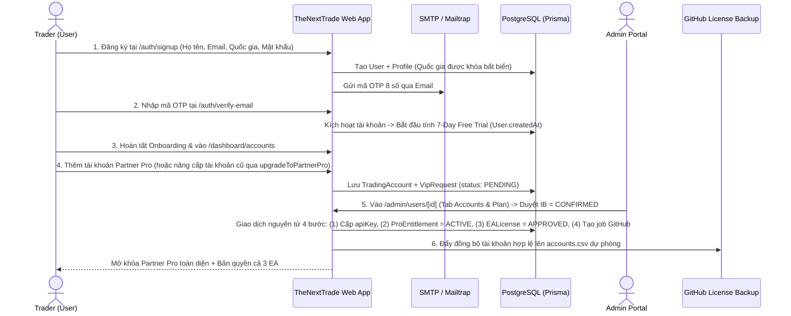
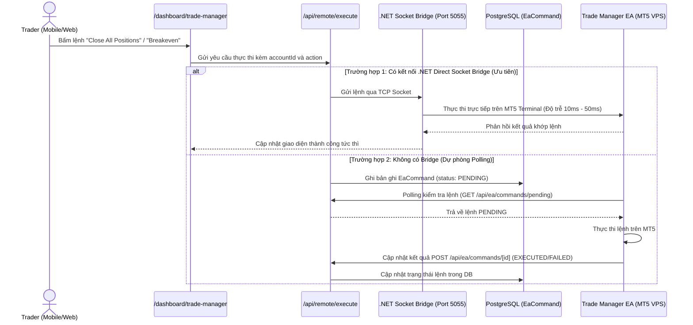
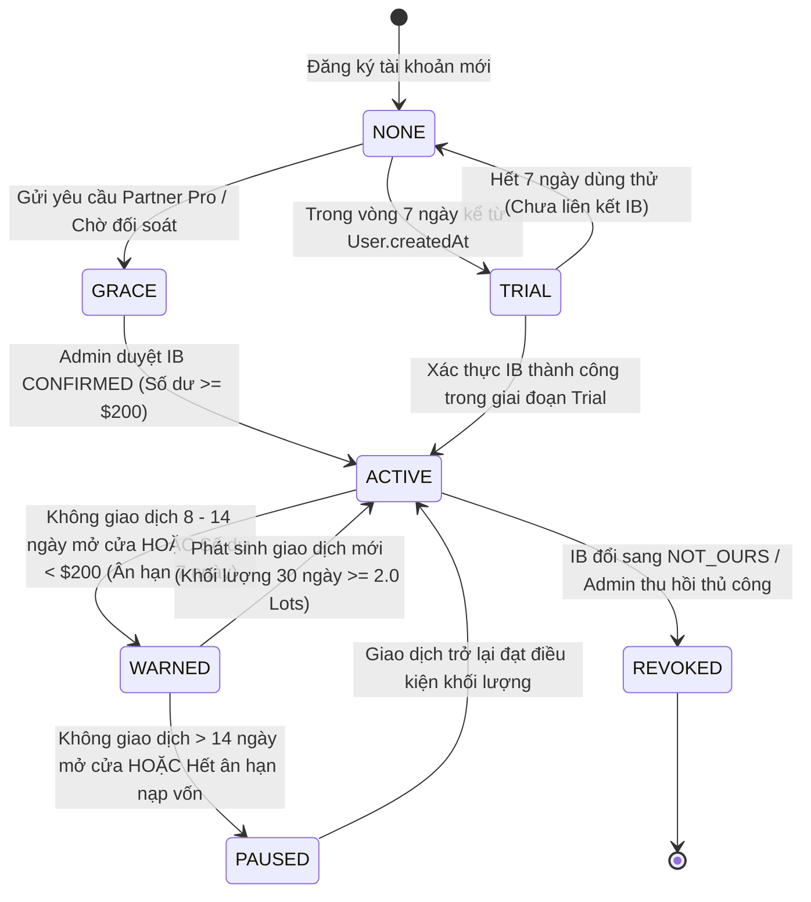
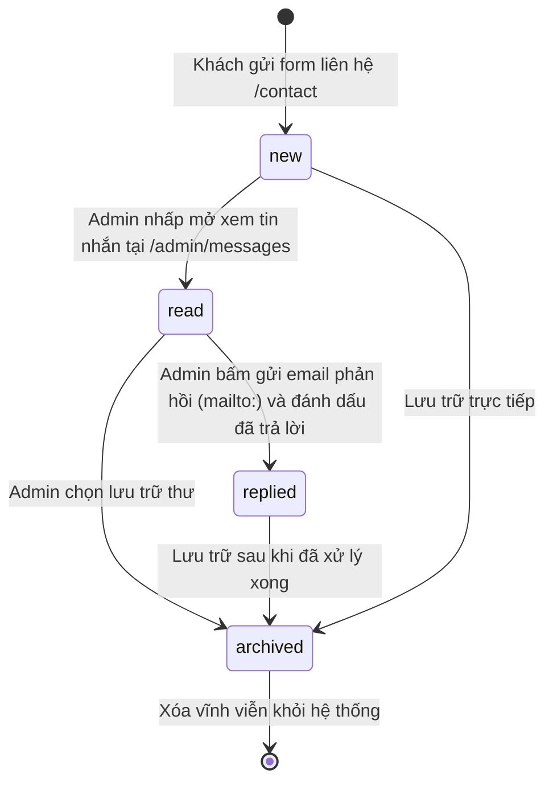

# TÀI LIỆU ĐẶC TẢ NGHIỆP VỤ TỔNG THỂ (MASTER BA SPECIFICATION / SRS)
**Dự án:** TheNextTrade (Hệ sinh thái Quản trị Giao dịch, Phân tích Hành vi & Tự động hóa MT5 — GoldScalperNinja Ecosystem)  
**Phiên bản:** 3.5 (World-Class BA Specification — Fully Codebase-Aligned & BDD-Ready)  
**Cập nhật lần cuối:** 2026-10-29  
**Stack công nghệ:** Next.js 15 (App Router), React 19, TypeScript, Tailwind CSS v4, Prisma ORM (PostgreSQL / Supabase), Supabase Auth, Nodemailer (SMTP/Mailtrap), OpenRouter AI Gateway, .NET MT5 Direct Socket Bridge microservice (Port 5055).

---

## MỤC LỤC
1. [Phần 1: Tổng quan Hệ thống & Mô hình Kinh doanh (Business Overview & RBAC)](#phần-1-tổng-quan-hệ-thống-mô-hình-kinh-doanh-business-overview-rbac)
2. [Phần 2: Phân hệ Public & Acquisition (Khách vãng lai & Chuyển đổi)](#phần-2-phân-hệ-public-acquisition-khách-vãng-lai-chuyển-đổi)
3. [Phần 3: Phân hệ Xác thực, Bảo mật & Onboarding (Auth & Activation)](#phần-3-phân-hệ-xác-thực-bảo-mật-onboarding-auth-activation)
4. [Phần 4: Phân hệ Quản lý Tài khoản Giao dịch & Đồng bộ (Account Hub & Sync)](#phần-4-phân-hệ-quản-lý-tài-khoản-giao-dịch-đồng-bộ-account-hub-sync)
5. [Phần 5: Phân hệ Nhật ký Giao dịch, Phân tích & AI Coaching (Core Trading Loop)](#phần-5-phân-hệ-nhật-ký-giao-dịch-phân-tích-ai-coaching-core-trading-loop)
6. [Phần 6: Phân hệ Hệ sinh thái EA, Trade Manager Remote & MT5 Cloud Sync](#phần-6-phân-hệ-hệ-sinh-thái-ea-trade-manager-remote-mt5-cloud-sync)
7. [Phần 7: Phân hệ Học viện, Gamification & Giữ chân Người dùng (Academy & Retention)](#phần-7-phân-hệ-học-viện-gamification-giữ-chân-người-dùng-academy-retention)
8. [Phần 8: Phân hệ Quản trị Hệ thống — Admin Portal (Toàn bộ Modules)](#phần-8-phân-hệ-quản-trị-hệ-thống-admin-portal-toàn-bộ-modules)
9. [Phần 9: Sơ đồ Luồng Nghiệp vụ Trọng yếu & Máy trạng thái (Business Workflows & State Machines)](#phần-9-sơ-đồ-luồng-nghiệp-vụ-trọng-yếu-máy-trạng-thái-business-workflows-state-machines)
10. [Phần 10: Danh mục API, Cron Jobs & Từ điển Dữ liệu (Technical & Data Appendix)](#phần-10-danh-mục-api-cron-jobs-từ-điển-dữ-liệu-technical-data-appendix)
11. [Phần 11: Tiêu chí Chấp nhận BDD & Bảng Quyết định Nghiệp vụ (Acceptance Criteria & Decision Tables)](#phần-11-tiêu-chí-chấp-nhận-bdd-bảng-quyết-định-nghiệp-vụ-acceptance-criteria-decision-tables)

---

## PHẦN 1: TỔNG QUAN HỆ THỐNG & MÔ HÌNH KINH DOANH (BUSINESS OVERVIEW & RBAC)

### 1.1. Mục tiêu Sản phẩm (Product Vision)
**TheNextTrade** là hệ điều hành giao dịch (Trading Operating System) dành cho nhà giao dịch Forex/Gold (đặc biệt trên nền tảng MetaTrader 5). Hệ thống kết nối trực tiếp dữ liệu thực thi lệnh từ MT5 thông qua **Trade Manager EA** (hoặc ghi chép thủ công qua **Manual Journal**), phân tích rò rỉ hành vi (behavioral leaks), kiểm soát rủi ro và chuyển hóa thành **một kế hoạch hành động cụ thể mỗi tuần (Weekly Coach Action Plan)**.

- **Thương hiệu nền tảng (Global Platform Brand):** `TheNextTrade`
- **Thương hiệu Cộng đồng & Hệ thống EA (Community & EA Ecosystem Brand):** `GoldScalperNinja`

### 1.2. Mô hình Kinh doanh & Hạn ngạch Phân tầng (IB Business Model & Tier Quotas)
Khác với các phần mềm SaaS thu phí thuê bao tháng, **TheNextTrade miễn phí 100% ($0) cho Trader**:
- **Nguồn thu chính:** Hoa hồng IB (Introducing Broker Rebate / Commission per lot) từ các sàn đối tác chiến lược (**Exness, Vantage Markets, VT Markets, Ultima Markets**).
- **Cơ chế Mở khóa Đặc quyền (Partner Pro & EA Unlock):**
  - Khi Trader mở tài khoản giao dịch thực (Live Account) dưới mã IB của hệ thống và được Admin xác thực (`ibAttribution = CONFIRMED`), tài khoản đó tự động được cấp **Partner Pro (`ProEntitlement.status = ACTIVE`)** và cấp **1 License Key duy nhất mở khóa toàn bộ 3 sản phẩm EA** (`Trade Manager EA`, `GoldScalperNinja EA`, `GSN - Apex Gold Sentinel / Phoenix Grid`).
- **Chính sách Dùng thử & Hạn ngạch Gói Miễn phí (Trial & Free Tier Quotas):**
  - **7-Day Free Trial (Dùng thử 7 ngày):** Mọi tài khoản mới đăng ký đều tự động được kích hoạt dùng thử Partner Pro trong **chính xác 7 ngày theo lịch** kể từ thời điểm tạo tài khoản (`TRIAL_DURATION_DAYS = 7` trong `src/lib/pro-access.ts:16` tính từ `User.createdAt`). Trong 7 ngày này, người dùng trải nghiệm không giới hạn toàn bộ bộ 3 EA, AI Intelligence và không bị giới hạn số tài khoản.
  - **Free Tier (Hạn ngạch gói miễn phí sau Trial):** Sau khi hết 7 ngày dùng thử mà chưa liên kết tài khoản IB hợp lệ, tài khoản chuyển về Free Tier:
    - **Hạn ngạch tài khoản kết nối:** Được kết nối tối đa **2 tài khoản giao dịch đồng thời** (`src/actions/accounts.ts:270` kiểm tra `existingCount >= 2`).
    - **Tính năng khả dụng:** Nhật ký giao dịch thủ công và đồng bộ cơ bản, xem thống kê Dashboard, cá nhân hóa Rules.
    - **Giới hạn:** Bị giới hạn mở khóa EA tự động (chỉ cho phép dùng thử Demo), giới hạn phân tích AI chuyên sâu.

### 1.3. Kiến trúc Giữ chân Trader 2 Lớp (Two-Layer Active Retention Architecture)
Để đảm bảo Trader duy trì giao dịch thực chất dưới IB và hệ thống không phải chịu chi phí vận hành cho các tài khoản không hoạt động, TheNextTrade áp dụng mô hình đánh giá 2 lớp độc lập (`src/lib/pro-access.ts`):
1. **Lớp 1: Cấp quyền Cơ sở Dữ liệu (Database Entitlement Layer):**
   - Lưu trữ trong bảng `ProEntitlement`: `status ∈ { NONE, GRACE, ACTIVE, EXPIRED, REVOKED }`, `source ∈ { IB_VERIFIED, MANUAL_ADMIN, PROMO }`.
2. **Lớp 2: Chính sách Hoạt động Động tại Runtime (Dynamic Inferred Activity Policy Layer):**
   - Đánh giá tại thời điểm request thông qua hàm `evaluateActivityPolicy()` cho ra 3 trạng thái thực thi: `ACTIVE`, `WARNED`, `PAUSED`.
   - **Các điều kiện đánh giá:**
     - **Sàn giao dịch hợp lệ:** Broker thuộc danh mục VIP (`VANTAGE`, `EXNESS`, `VTMARKETS`, `ULTIMAMARKETS`).
     - **Tài khoản Live:** Phải là tài khoản giao dịch thực (loại trừ Demo, Contest, Evaluation, Prop Firm Challenge).
     - **Số dư duy trì tối thiểu (Funding Check):** Số dư tài khoản $\ge \$200$ (Cent Account được quy đổi chuẩn hóa: chia 100). Nếu $< \$200$, kích hoạt 7 ngày gia hạn nạp vốn (`FUNDING_GRACE_DAYS = 7`).
     - **Khối lượng giao dịch 30 ngày (Rolling 30d Volume):** Tổng khối lượng khớp lệnh từ nguồn đồng bộ hợp lệ (`EA_SYNC`, `EA_HISTORY`, `SUPPORT_SYNC`, `CLOUD_WORKER`) trong 30 ngày gần nhất phải đạt $\ge 2.0\text{ Lots}$. Lệnh nhập tay (Manual) không được tính vào khối lượng xét VIP.
     - **Thời gian không giao dịch (Inactivity Trading Days):** Tính số ngày thị trường mở cửa (chỉ tính thứ Hai đến thứ Sáu UTC qua `countTradingDaysBetween`, bỏ qua thứ Bảy & Chủ Nhật). Nếu từ 8–14 ngày không phát sinh lệnh đóng $\rightarrow$ cảnh báo (`WARNED`). Nếu $> 14$ ngày $\rightarrow$ tạm dừng đặc quyền Partner Pro (`PAUSED` / chuyển về Free Tier).

### 1.4. Ma trận Phân quyền Người dùng (Role-Based Access Control — RBAC)

| Vai trò (Role / Tier) | Định danh trong Cơ sở Dữ liệu | Quyền hạn & Phạm vi Truy cập |
| :--- | :--- | :--- |
| **Anonymous (Khách vãng lai)** | Chưa có phiên đăng nhập | Truy cập các route công khai (`/`, `/about`, `/tools/*`, `/trading-style`, `/community`, `/articles/*`, `/legal/*`). Sử dụng 16 công cụ tính toán, làm trắc nghiệm tâm lý 14 câu, xem thẻ hồ sơ công khai (`/trader/[username]`, `/share/[id]`). |
| **Free Trader (`USER`)** | `Profile.role = USER`, không có `ProEntitlement` ACTIVE, đã hết 7 ngày Trial | Kết nối tối đa **2 tài khoản giao dịch** (`src/actions/accounts.ts:270`), đồng bộ lệnh qua Trade Manager EA cơ bản hoặc ghi lệnh thủ công, xem Dashboard, Journal, Rules, Academy, Missions. |
| **Trial Trader (`USER`)** | `Profile.role = USER`, trong vòng 7 ngày kể từ `User.createdAt` | Trải nghiệm toàn bộ quyền lợi Partner Pro: không giới hạn tài khoản, mở khóa 3 EA trên môi trường Demo/Live, truy cập AI Intelligence, không yêu cầu thẻ tín dụng. |
| **Partner Pro Trader (`USER`)** | `Profile.role = USER` + `ProEntitlement.status = ACTIVE` (được xác thực IB hoặc Admin cấp thủ công) | Không giới hạn số tài khoản kết nối, 1 License Key mở khóa cả 3 EA, điều khiển từ xa qua Mobile Remote, phân tích AI chuyên sâu, tham gia Loyalty Rewards. |
| **Content Editor (`EDITOR`)** | `Profile.role = EDITOR` (thuộc enum `UserRole { USER, EDITOR, ADMIN }`) | Quản lý biên tập bài viết chuẩn SEO (`/admin/articles/*`), danh mục, thẻ phân loại (`/admin/taxonomy`) và tài liệu học viện. |
| **Administrator (`ADMIN`)** | `Profile.role = ADMIN` (bảo vệ bởi `requireAdminPageAccess()`) | Toàn quyền kiểm soát `/admin/*`: Quản lý người dùng, đóng vai Trader (Impersonate), duyệt IB/VIP, cấp/thu hồi EA License, kiểm tra tin nhắn khách hàng (`/admin/messages`), vận hành MT5 Cloud Fleet, AI Gateway, Security Logs. |

*(Lưu ý về lược đồ Prisma: Không tồn tại thuộc tính `User.isVip` hay giá trị enum `UserRole.INSTRUCTOR`. Toàn bộ trạng thái Pro/VIP được quản lý thông qua model `ProEntitlement` và enum `UserRole` chỉ gồm 3 giá trị: `USER`, `EDITOR`, `ADMIN`).*

---

## PHẦN 2: PHÂN HỆ PUBLIC & ACQUISITION (KHÁCH VÃNG LAI & CHUYỂN ĐỔI)

### 2.1. Trang chủ & Các trang Giới thiệu (`/`, `/get-started`, `/about`, `/edge`, `/faq`, `/contact`, `/legal/*`)
| Route | Tên chức năng | Đặc tả Nghiệp vụ & Ràng buộc Kỹ thuật |
| :--- | :--- | :--- |
| `/` | Homepage | Trình bày định vị hệ điều hành giao dịch thực chiến, minh chứng thực tế từ cộng đồng Telegram, chu trình cải thiện hiệu suất, hệ thống 3 EA và đối tác sàn. Tuyệt đối không hiển thị số liệu ảo, không chứa danh mục Prop Firm. |
| `/get-started` | Bắt đầu nhanh (Launchpad) | - **Chưa đăng nhập:** Lộ trình 4 bước từ đăng ký đến phân tích lệnh đầu tiên kèm CTA `/auth/signup`.<br>- **Đã đăng nhập:** Bảng **Personalized Launch Checklist** kiểm tra tiến độ thực tế (Tạo tài khoản MT5, Đồng bộ lệnh đầu tiên, Xem báo cáo tuần). |
| `/about`, `/edge`, `/faq` | Giới thiệu & Giải đáp | Triết lý bảo toàn vốn ("Capital preservation first"), cơ chế tích lũy điểm kỷ luật **Edge Score**, giải đáp mô hình $0 qua IB. |
| `/contact` | Form Liên hệ Hỗ trợ | Form gửi tin nhắn lưu trực tiếp vào bảng `ContactMessage`. Tích hợp **Honeypot chống bot** (`website`, `phone_hp` — nếu bot điền giá trị thì hệ thống âm thầm chấp nhận giả mà không lưu DB) và **Rate Limiting bộ nhớ** (tối đa 3 lần gửi / 5 phút trên mỗi IP và Email). |
| `/legal/*` | Pháp lý & Điều khoản | `/legal/privacy-policy`, `/legal/terms-of-service`, `/legal/cookie-policy`. Truy cập công khai không yêu cầu xác thực. |

### 2.2. Trắc nghiệm Phong cách Giao dịch — Trading Style Assessment (`/trading-style`)
- **Mục đích:** Lead magnet phân loại tâm lý Trader và cá nhân hóa lộ trình rèn luyện kỷ luật.
- **Quy tắc Nghiệp vụ:**
  1. **Welcome Screen:** Luôn hiển thị màn hình giới thiệu đầu tiên; không tự động nhảy vào câu hỏi khi refresh trang.
  2. **14 Câu hỏi Tình huống:** Đánh giá trên **6 chiều tâm lý** (Khẩu vị rủi ro, Tốc độ ra quyết định, Kiểm soát cảm xúc, Độ sâu phân tích, Tuân thủ kỷ luật, Khả năng thích ứng).
  3. **Phân loại 8 Archetypes:** Tự động xếp vào 1 trong 8 hình mẫu giao dịch kèm ma trận điểm mạnh, điểm mù (blind spots) và quy tắc bảo vệ vốn.
  4. **Tích hợp Dashboard & Profile:** Khi người dùng đăng nhập, kết quả được lưu vào `User.tradingStyleProfile`. Các khuyến nghị quy tắc và phong cách giao dịch điều hướng trực tiếp về trang thiết lập kỷ luật `/dashboard/rules`.

### 2.3. Cộng đồng GoldScalperNinja (`/community`)
- Hiển thị bài viết thực chiến chọn lọc theo 4 tab thị trường: **Forex, Crypto, Indices, Commodities** (mỗi tab 10 bài, tích hợp nút Shuffle ngẫu nhiên).
- Hỗ trợ xem ảnh phóng to (Media Lightbox), thả cảm xúc tương tác (`/api/community/reactions`) và khối điều hướng đăng ký tài khoản sàn nhận đặc quyền.

### 2.4. Danh mục Hệ thống EA (`/trading-systems`, `/trading-systems/[slug]`)
- Giới thiệu 3 sản phẩm thuật toán MT5:
  1. **Trade Manager EA (`trade-manager`):** Quản lý lệnh bán tự động, tính lot rủi ro %, dời SL hòa vốn, điều khiển từ xa qua điện thoại và đồng bộ lịch sử.
  2. **GoldScalperNinja EA (`goldscalperninja`):** Giao dịch tự động XAUUSD với bộ lọc phiên và kiểm soát sụt giảm tài khoản.
  3. **GSN - Apex Gold Sentinel / Phoenix Grid (`gsn-phoenix-grid`):** Giao dịch lưới thuật toán thông minh với cơ chế thoát lệnh bảo vệ tài khoản cứng.
- Ràng buộc: Không sử dụng simulator giả lập lợi nhuận; công khai thông số kiểm soát rủi ro và hướng dẫn cài đặt.

### 2.5. Danh mục Sàn Đối tác (`/brokers`)
- Hiển thị thông tin các sàn đối tác chiến lược (**Exness, Vantage, VT Markets, Ultima Markets**), ưu đãi hoàn phí, spread, đòn bẩy, link đăng ký IB (`EABroker.affiliateUrl`) và hướng dẫn chuyển đổi mã IB.

### 2.6. Bộ 16 Công cụ Tính toán Giao dịch (`/tools/*`)
Hỗ trợ tính toán quản trị vốn và phục vụ SEO tự nhiên (theo dõi qua `ToolView` và `/api/tools/views`):
1. `/tools/position-size-calculator` — Tính Lot chuẩn xác theo % rủi ro và khoảng cách SL.
2. `/tools/pip-value-calculator` — Giá trị mỗi Pip theo cặp tiền và khối lượng.
3. `/tools/margin-calculator` — Ký quỹ yêu cầu theo đòn bẩy.
4. `/tools/profit-loss-calculator` — Ước tính Lãi/Lỗ trước khi vào lệnh.
5. `/tools/risk-reward-calculator` — Tỷ lệ R:R và tỷ lệ thắng hòa vốn.
6. `/tools/drawdown-calculator` — Mức sụt giảm liên tiếp và % cần gỡ hòa vốn.
7. `/tools/compounding-calculator` — Mô hình tăng trưởng lãi kép.
8. `/tools/risk-of-ruin-calculator` — Xác suất cháy tài khoản theo công thức thống kê rủi ro.
9. `/tools/leverage-calculator` — Tính đòn bẩy thực tế đang sử dụng.
10. `/tools/fibonacci-calculator` — Các mốc thoái lui và mở rộng Fibonacci.
11. `/tools/pivot-point-calculator` — Các ngưỡng Pivot đa khung.
12. `/tools/correlation-matrix` — Ma trận tương quan các cặp tiền tệ (`/api/tools/correlation`).
13. `/tools/currency-converter` — Quy đổi tiền tệ thời gian thực (`/api/tools/convert`).
14. `/tools/currency-heat-map` — Bản đồ nhiệt sức mạnh đồng tiền.
15. `/tools/live-market-rates` & `/tools/market-hours` — Bảng giá trực tiếp và đồng hồ 4 phiên giao dịch.
16. `/tools/economic-calendar` — Lịch kinh tế vĩ mô lấy từ bảng `EconomicEvent` (đồng bộ tự động qua cron `/api/cron/sync-events`).

### 2.7. Bài viết & Hồ sơ Giao dịch Công khai (`/articles/*`, `/trader/[username]`, `/share/[id]`)
- **Articles & Knowledge Hub:** Blog chuẩn SEO, phân mục theo danh mục (`Category`) và thẻ (`Tag`), hỗ trợ bình luận (`Comment`) và bình chọn hữu ích (`ArticleVote`).
- **Public Trader Card (`/trader/[username]`):** Hồ sơ giao dịch cá nhân với 3 chế độ riêng tư (ẩn số tiền tuyệt đối, chỉ hiện % tăng trưởng/R-multiple, hiển thị phù hiệu phong cách giao dịch và chỉ số xác thực đồng bộ MT5).

---

## PHẦN 3: PHÂN HỆ XÁC THỰC, BẢO MẬT & ONBOARDING (AUTH & ACTIVATION)

### 3.1. Đăng ký & Bất biến Quốc gia (`/auth/signup`, `src/app/api/profile/route.ts`)
- **Luồng 2 bước gọn nhẹ:**
  - **Bước 1:** Nhập Họ tên, Email, Quốc gia (tự động gợi ý qua `/api/geo/country`).
  - **Bước 2:** Nhập mật khẩu mạnh, đồng ý Điều khoản, kiểm tra Cloudflare Turnstile, ghi nhận mã người giới thiệu (`referredBy`).
- **Quy tắc Bất biến Quốc gia (Country Immutability Invariant):**
  - Khi hồ sơ người dùng (`Profile.country`) đã được lưu vào hệ thống, giá trị này **vĩnh viễn không thể thay đổi** qua API cập nhật thông tin (`src/app/api/profile/route.ts:184-192`). Quy tắc này nhằm đảm bảo tính toàn vẹn của dữ liệu phân bổ địa lý và tuân thủ chính sách sàn IB.
- **Xác thực OTP qua Email:**
  - Khi đăng ký, hệ thống gọi Supabase sinh mã OTP 8 chữ số và gửi email giao diện thương hiệu TheNextTrade (`buildSignupOtpEmailHtml`) qua SMTP/Mailtrap, chuyển hướng người dùng sang `/auth/verify-email`.

### 3.2. Xác thực Email OTP & Kích hoạt 7-Day Trial (`/auth/verify-email`)
- Người dùng nhập mã OTP 8 chữ số. Có cơ chế Resend kèm bộ đếm ngược chống spam.
- Ngay khi xác thực thành công:
  - Bản ghi `User` và `Profile` được kích hoạt.
  - Thời điểm `User.createdAt` chính thức bắt đầu kích hoạt đồng hồ đếm ngược **7-Day Free Trial**.
  - Tự động chuyển hướng người dùng sang quy trình Onboarding.

### 3.3. Đăng nhập, 2FA & Bảo mật Phiên (`/auth/login`, `/auth/verify-2fa`)
- Xác thực qua Supabase Auth, ghi vết nhật ký bảo mật vào `SecurityLog` (`LOGIN_SUCCESS` / `LOGIN_FAILED` kèm IP và User-Agent).
- Hỗ trợ bảo mật 2 lớp (2FA TOTP): nếu `User.twoFactorEnabled = true`, bắt buộc nhập mã 6 số từ ứng dụng Authenticator trước khi cấp session vào Dashboard.

### 3.4. Khảo sát Định hướng Ban đầu — Onboarding 4 bước (`/onboarding`)
Dành cho tài khoản mới (`User.onboardingCompleted = false`):
1. **Bước 1 — Kinh nghiệm & Thị trường:** Beginner, Intermediate, Advanced và thị trường trọng tâm.
2. **Bước 2 — Mục tiêu Giao dịch Chính:** Bảo vệ vốn, kiểm soát cảm xúc, tối ưu thuật toán.
3. **Bước 3 — Phương thức Đồng bộ:** Lựa chọn **Trade Manager EA (MT5 Desktop/VPS)** hoặc **Manual Journal (Mobile/Nhập tay)**.
4. **Bước 4 — Hoàn tất & Điều hướng:** Lưu `User.onboardingCompleted = true` và chuyển thẳng tới First Session Wizard trên Dashboard.

### 3.5. Trợ lý Phiên Đầu tiên — First Session Wizard (`FirstSessionWizard.tsx`)
Hiển thị trên `/dashboard` để hướng dẫn hoàn tất 3 bước kích hoạt cốt lõi:
1. Thêm tài khoản giao dịch đầu tiên (`Add Trading Account`).
2. Kết nối Trade Manager EA đồng bộ hoặc ghi chép lệnh đầu tiên (`Verify Sync / Log Trade`).
3. Khám phá bản phân tích hiệu suất đầu tiên (`Review First Insight`).

---

## PHẦN 4: PHÂN HỆ QUẢN LÝ TÀI KHOẢN GIAO DỊCH & ĐỒNG BỘ (ACCOUNT HUB & SYNC)

### 4.1. Kiến trúc Phân giải Tài khoản Mặc định (Main Account Resolution Architecture)
Để đồng nhất dữ liệu hiển thị trên toàn bộ các widget và route con của Dashboard (`/dashboard`, `/dashboard/journal`, `/dashboard/analytics`, `/dashboard/sessions`, `/dashboard/intelligence`, `/dashboard/accounts`), hệ thống áp dụng cơ chế phân giải tài khoản chặt chẽ (`src/actions/main-account.ts`):

#### A. Thứ tự Ưu tiên 4 Tầng Phân giải (4-Tier Fallback Hierarchy):
Hàm `resolveDefaultAccountId(userId, cookieAccountId?)` thực thi truy vấn song song và phân giải theo thứ tự:
```
+---------------------------------------------------------------------------------+
| Ưu tiên 1 (Profile Main Account): profile.mainTradingAccountId                  |
| (Kiểm tra đối chiếu đảm bảo ID tài khoản này còn tồn tại và thuộc về user)     |
+---------------------------------------------------------------------------------+
                                       │ (null hoặc tài khoản đã bị xóa)
                                       ▼
+---------------------------------------------------------------------------------+
| Ưu tiên 2 (Cờ Mặc định Bảng): Tài khoản có TradingAccount.isDefault === true    |
+---------------------------------------------------------------------------------+
                                       │ (không có tài khoản nào đặt cờ)
                                       ▼
+---------------------------------------------------------------------------------+
| Ưu tiên 3 (Session Cookie): Cookie "last_account_id"                            |
| (Giá trị khác "all" và ID tài khoản có trong danh sách tài khoản của user)      |
+---------------------------------------------------------------------------------+
                                       │ (cookie trống hoặc không hợp lệ)
                                       ▼
+---------------------------------------------------------------------------------+
| Ưu tiên 4 (Fallback Thời gian): Tài khoản tạo gần nhất (userAccounts[0].id)     |
| (Sắp xếp theo [{ isDefault: "desc" }, { createdAt: "desc" }])                   |
+---------------------------------------------------------------------------------+
```
*(Nếu user chưa có tài khoản nào, hàm trả về `undefined`).*

#### B. Giao dịch Thiết lập Tài khoản Chính (`setMainAccount` Action):
Khi người dùng bấm chọn tài khoản chính tại `/dashboard/accounts`, hệ thống thực thi:
1. **Kiểm tra quyền sở hữu:** Xác thực `user.id` sở hữu `accountId` mục tiêu trong bảng `TradingAccount`.
2. **Giao dịch Nguyên tử (`prisma.$transaction`):**
   - Cập nhật `Profile.mainTradingAccountId = accountId`.
   - Đặt lại toàn bộ tài khoản của user: `TradingAccount.updateMany({ isDefault: false })`.
   - Nếu `accountId !== null`, cập nhật tài khoản được chọn: `TradingAccount.update({ isDefault: true })`.
3. **Đồng bộ Cookie Khách:** Thiết lập cookie `last_account_id` với thời hạn 1 năm (`maxAge: 31536000`, `path: "/"`, `sameSite: "lax"`). Nếu hủy chọn (`accountId === null`), xóa cookie.
4. **Tái xác thực Cache (Cache Revalidation):** Kích hoạt `revalidatePath` đồng thời trên **6 route Dashboard**:
   `["/dashboard/accounts", "/dashboard", "/dashboard/journal", "/dashboard/analytics", "/dashboard/sessions", "/dashboard/intelligence"]`.

### 4.2. Luồng Thêm Mới & Nâng cấp Tài khoản (`AddAccountModal.tsx`, `src/actions/account-pro.ts`)

#### A. Luồng Tạo Tài khoản Free (`createTradingAccount`):
- Cho phép kết nối tối đa **2 tài khoản** đối với người dùng Free Tier (`src/actions/accounts.ts:270`). Nếu người dùng cố tình thêm tài khoản thứ 3 khi chưa có Partner Pro, hệ thống từ chối với thông báo yêu cầu nâng cấp.
- Tự động sinh `User.syncApiKey` (chuỗi bảo mật 64 ký tự) nếu chưa có.

#### B. Luồng Tạo Tài khoản Partner Pro Mới (`createPartnerProAccount`):
- Xác thực Cloudflare Turnstile, kiểm tra schema thông tin tài khoản MT5.
- Kiểm tra trùng lặp: Ngăn chặn số tài khoản đã đăng ký bởi người dùng khác hoặc đã có yêu cầu `PENDING` cho cùng cặp broker + account number.
- **Tự động liên kết (Auto-linking):** Nếu tài khoản đã tồn tại bản ghi `ProEntitlement` được duyệt trước đó, hệ thống lập tức liên kết và mở khóa quyền lợi mà không cần chờ duyệt lại.
- Tạo bản ghi `TradingAccount` và `VipRequest`, đồng thời kích hoạt `linkIbLeadToVipRequest` để gắn kết hoa hồng IB.

#### C. Luồng Nâng cấp Tài khoản Hiện hữu (`upgradeToPartnerPro`):
- Giải quyết bài toán Trader đã tạo tài khoản Free trước đó và sau này chuyển đổi mã IB thành công:
  - Hàm `upgradeToPartnerPro(accountId, formData)` (`src/actions/account-pro.ts:311`) sử dụng chính bản ghi `TradingAccount` hiện có làm nguồn chân lý về Broker và Số tài khoản.
  - **Không tạo bản ghi tài khoản trùng lặp** gây rác dữ liệu.
  - Kiểm tra sàn giao dịch thuộc danh mục hợp lệ (`EXNESS`, `VANTAGE`, `VTMARKETS`, `ULTIMAMARKETS`).
  - Tạo bản ghi `VipRequest` gắn trực tiếp với `TradingAccount.id` và gửi thông báo tới đội ngũ Admin để thẩm định đối soát.

### 4.3. Trình Hướng dẫn Đồng bộ TradeSyncWizard 3 bước (`TradeSyncWizard.tsx`)
- **Step 1 — Sync API Key & Registered Accounts:** Hiển thị Sync API Key 64 ký tự kèm nút copy 1-click; danh sách tài khoản đã đăng ký và link tải `GoldScalperNinja_Sync.ex5`. Phát hiện thiết bị di động để cung cấp nút "Gửi link cài đặt về Email".
- **Step 2 — Cấu hình MetaTrader 5 WebRequest:** Hướng dẫn bật WebRequest trong MT5 và thêm URL máy chủ đồng bộ (`NEXT_PUBLIC_SYNC_SERVER_URL`).
- **Step 3 — Kiểm tra Kết nối Tự động:** Quét 4 chỉ số qua `/api/sync/status` (API Key tồn tại, Account đã đăng ký, Nhịp tim Heartbeat được phát hiện, Lệnh giao dịch đã đồng bộ). Tích hợp bảng hỗ trợ xử lý sự cố kết nối.

---

## PHẦN 5: PHÂN HỆ NHẬT KÝ GIAO DỊCH, PHÂN TÍCH & AI COACHING (CORE TRADING LOOP)

### 5.1. Bảng điều khiển Tổng quan Thích ứng (`/dashboard`)
- **Ngữ cảnh chưa có dữ liệu:** Ẩn toàn bộ biểu đồ trống và bộ lọc rỗng; tập trung hiển thị First Session Wizard thúc đẩy Trader kết nối MT5 hoặc ghi lệnh đầu tiên.
- **Ngữ cảnh đã có dữ liệu:**
  - Dãy chỉ số cốt lõi: **Net P&L, Win Rate, Profit Factor, Expectancy, Average R:R, Max Drawdown**.
  - Biểu đồ biến động vốn (**Equity Curve**) và lịch lãi/lỗ theo tháng (**PnL Calendar**).
  - Khối **One Next Action**: Hiển thị duy nhất 1 nhiệm vụ sửa sai trọng tâm nhất trong tuần do AI Coach đề xuất.

### 5.2. Nhật ký Giao dịch Chi tiết (`/dashboard/journal`)
- Bộ lọc đa tiêu chí: Tài khoản, khoảng thời gian, cặp tiền (`Symbol`), chiều lệnh (`BUY`/`SELL`), kết quả (`WIN`/`LOSS`/`BREAKEVEN`), chiến lược (`Strategy`), sai lầm mắc phải (`Mistakes`).
- Thông số chi tiết trên từng `JournalEntry`: Giá vào/ra, SL/TP, Lot, Commission, Swap, P&L ròng, MAE/MFE (sụt giảm và lợi nhuận tối đa trong phiên giữ lệnh), mức độ tự tin, cảm xúc trước/sau lệnh, ghi chú tâm lý và ảnh chụp biểu đồ đính kèm.
- Hỗ trợ ghi chép nhận định theo ngày (`TradingDayNote`), import file lịch sử từ MT4/MT5 (`/api/import/*`) và export dữ liệu ra CSV/JSON.

### 5.3. Phân tích Phiên & Phân tích Đa chiều (`/dashboard/sessions`, `/dashboard/analytics`)
- **Phân tích theo Phiên (`/dashboard/sessions`):** Bóc tách hiệu suất trên 4 phiên (**Asian, London, Overlap, New York**) để chỉ ra phiên giao dịch có lợi thế thực sự (Positive Expectancy) và phiên thường xuyên bị thua lỗ.
- **Phân tích Rò rỉ Hành vi (Behavioral Leak Radar):** Đánh giá các lỗi kỷ luật giao dịch (Gồng lỗ quá mức, Bỏ Stop Loss, Giao dịch trả thù, Đánh quá khối lượng) và quy đổi trực tiếp thành số tiền thiệt hại cụ thể.

### 5.4. Trung tâm Phân tích Trí tuệ Nhân tạo — AI Intelligence (`/dashboard/intelligence`)
- Kết nối thông qua **Internal AI Gateway (`/api/v1/ai/analyze`)**, tuyệt đối không gọi trực tiếp từ client ra OpenRouter.
- Tổng hợp dữ liệu lệnh và tín hiệu `TraderSignal` để trả về 3 phần phân tích thực chiến:
  1. Rủi ro hành vi nguy hiểm nhất cần chặn đứng.
  2. Lợi thế giao dịch đang mang lại lợi nhuận cao nhất.
  3. Kế hoạch hành động 10 lệnh tiếp theo (**10-Trade Sprint**).

### 5.5. Báo cáo Tuần & Kế hoạch Huấn luyện (`/dashboard/reports/weekly`)
- **Signal Engine (`src/lib/coach/signal-engine.server.ts`):** Quét phát hiện các thói quen xấu (nhồi lệnh khi lỗ, giao dịch quá nhiều sau chuỗi thua).
- **Weekly Coach Action Plan:** Cấu trúc 3 khối rõ ràng: **Keep Doing** (Duy trì thế mạnh), **Fix Next** (Sửa lỗi rò rỉ vốn), và **Action Checklist** (Việc cần làm).
- **Thử nghiệm Kỷ luật (`ImprovementExperiment`):** Khởi tạo thử nghiệm 7–14 ngày. Khi hoàn thành đạt mục tiêu, có thể chuyển hóa thành **Quy tắc Cứng (`TradingRule`)**.

### 5.6. Quy tắc, Mục tiêu & Chiến lược (`/dashboard/rules`, `/dashboard/strategies`)
- Quản lý bộ quy tắc giao dịch cá nhân (`TradingRule`), thiết lập mục tiêu định lượng (`TraderGoal`), kiểm tra tuân thủ quy tắc trước khi vào lệnh (`TradePlan` & `TradeRuleCheck`).
- Quản lý danh mục chiến lược (Playbook/Setups) và đo lường hiệu suất riêng cho từng chiến lược.

---

## PHẦN 6: PHÂN HỆ HỆ SINH THÁI EA, TRADE MANAGER REMOTE & MT5 CLOUD SYNC

### 6.1. Bảng Quản lý Bản quyền EA — License Accounts Panel (`LicenseAccountsPanel.tsx`)
Nằm tại `/dashboard/trading-systems`, quản lý quyền sử dụng bộ 3 EA với các quy tắc kỹ thuật chuẩn hóa:

#### A. Cơ chế 1 License Mở khóa Cả 3 EA:
Mỗi tài khoản MT5 được phê duyệt sẽ sở hữu **1 mã License Key duy nhất** (lưu tại `TradingAccount.apiKey`), đồng thời mở khóa:
1. `trade-manager` (Trade Manager EA)
2. `goldscalperninja` (GoldScalperNinja EA)
3. `gsn-phoenix-grid` (GSN Phoenix Grid / Apex Gold Sentinel)

#### B. Đăng ký Bản quyền Hàng loạt (Batch License Requests):
- Hàm `submitMultipleAccountRequests(selectedAccountIds: string[])`:
  - Cho phép người dùng tick chọn nhiều tài khoản cùng lúc (có hỗ trợ Select All / Deselect All).
  - Tự động lọc các tài khoản có trạng thái chưa đăng ký, bị từ chối hoặc hết hạn.
  - Tạo yêu cầu bản quyền hàng loạt (`EALicense` trạng thái `PENDING`) và phát thông báo tới Admin.

#### C. Chỉnh sửa Trực tiếp Số Tài khoản MT4/MT5 (Inline Login Number Editing):
- Đối với các tài khoản chưa có số tài khoản giao dịch cụ thể, người dùng có thể nhập số trực tiếp ngay trên bảng giao diện thông qua `updateTradingAccountLoginNumber(tradingAccountId, accountNumber)`.
- Ràng buộc kiểm tra định dạng số nghiêm ngặt: từ 4 đến 20 chữ số (`/^\d{4,20}$/`).

#### D. Hiển thị, Che giấu Khóa & Sao chép Clipboard:
- Mặc định che giấu khóa dạng mặt nạ bảo mật: `TNT-****-****-1234` (`maskSyncApiKey`).
- Nút bật/tắt (Eye / EyeOff) để xem toàn bộ chuỗi khóa.
- Nút Copy 1-click tích hợp `navigator.clipboard.writeText` với phản hồi trực quan (Checkmark animation).

#### E. Hướng dẫn Thiết lập MT5 WebRequest (Chống lỗi 4014 / 4060):
Bảng hướng dẫn trực quan yêu cầu người dùng thêm đủ **3 URL bắt buộc** vào MT5 (Tools $\rightarrow$ Options $\rightarrow$ Expert Advisors $\rightarrow$ Allow WebRequest):
1. `https://thenexttrade.com` (Cổng xác thực chính — Primary Verification API)
2. `https://api.github.com` (Cổng API dự phòng — Backup Verification API)
3. `https://raw.githubusercontent.com` (Cổng dữ liệu tĩnh dự phòng thảm họa — High-Availability Fallback)

#### F. Ràng buộc Rắn 1-Kèm-1 trên Tài khoản Real (`/api/ea/license/verify`):
- Endpoint xác thực kiểm tra mã `licenseKey` đối chiếu với `TradingAccount.apiKey`.
- **Ràng buộc:** Nếu là tài khoản Real (`!isDemo`), hệ thống kiểm tra `accountByKey.accountNumber === rawAccount`. Nếu số tài khoản thực tế trên MT5 khác với số tài khoản đăng ký cấp phép, hệ thống lập tức từ chối với mã lỗi HTTP 403 `ACCOUNT_MISMATCH`. Mã bản quyền của Tài khoản A tuyệt đối không thể đem sang chạy trên Tài khoản B.
- **Bỏ qua đối với Demo:** Nếu phát hiện tham số tài khoản Demo/Contest, hệ thống cấp quyền chạy thử nghiệm (`DEMO_AUTHORIZED`, `expiryDate: "2099-12-31"`) nhưng loại trừ hoàn toàn khỏi số liệu vốn thực và hoa hồng IB.

### 6.2. Kiến trúc Điều khiển Từ xa Lai (Hybrid Remote Control Execution Architecture)
Cung cấp giải pháp điều khiển lệnh khẩn cấp từ Web/Mobile (`/dashboard/trade-manager`) tới MT5 terminal với mô hình lai 2 cơ chế:

```
+----------------------------------------------------------------------------------------------------+
|                                    GIAO DIỆN WEB / MOBILE                                          |
|                          (/dashboard/trade-manager: Close All, Derisk, SL)                         |
+----------------------------------------------------------------------------------------------------+
                                                  │
                                                  ▼
                                POST /api/remote/execute
                                                  │
                 ┌────────────────────────────────┴────────────────────────────────┐
                 │                                                                 │
                 ▼ (Ưu tiên 1: Có Cloud Socket Bridge)                             ▼ (Ưu tiên 2: Polling Dự phòng)
+--------------------------------------------------+             +-----------------------------------+
| .NET MT5 Direct Socket Bridge (Cổng 5055)        |             | Bảng EaCommand (PostgreSQL DB)    |
| - Kết nối TCP Socket trực tiếp với MT5 Terminal  |             | - Lưu lệnh với status = PENDING   |
| - Độ trễ thực thi siêu tốc: 10ms - 50ms          |             | - MQL5 EA polling định kỳ 1 - 5s  |
| - Truyền Telemetry thời gian thực qua SSE        |             |   qua GET /api/ea/commands/pending|
| - Quy tắc bảo vệ 24/5 vũ trang trên máy chủ      |             | - Phản hồi POST /api/ea/commands/ |
|   (Price Alert, Giới hạn Lỗ Ngày tự động cắt)    |             |   [id] (status = EXECUTED/FAILED) |
+--------------------------------------------------+             +-----------------------------------+
```

1. **Giao thức Ưu tiên 1: Cloud Direct Socket Bridge (.NET Microservice):**
   - Kết nối qua biến môi trường `MT5_BRIDGE_URL` (mặc định `http://127.0.0.1:5055`).
   - Xử lý các lệnh can thiệp tức thời (**BREAKEVEN_ALL, CLOSE_ALL, TRIM_2, DERISK, CUT_LOSS_5_PIPS, SECURE_50**) với độ trễ chỉ **10–50 mili-giây**, bỏ qua độ trễ polling của WebRequest.
   - Duy trì quy tắc bảo vệ 24/5 ngay cả khi Trader đóng ứng dụng điện thoại.
2. **Giao thức Dự phòng 2: Bảng Hàng đợi Lệnh Bất đồng bộ (`EaCommand` Table Polling):**
   - Dành cho các thiết lập VPS cá nhân độc lập không kết nối Socket Bridge.
   - Web ghi nhận `EaCommand` với trạng thái `PENDING`. Trade Manager EA quét lệnh qua `GET /api/ea/commands/pending`, thực thi trên MT5 và cập nhật trạng thái `EXECUTED` hoặc `FAILED`.

### 6.3. Hạ tầng Máy chủ Đồng bộ MT5 Cloud Worker (`Mt5Worker`)
- Quản lý cụm máy chủ Windows Worker chạy đa tiến trình MT5 Terminal qua mã kết nối `Mt5EnrollmentToken`.
- Tự động ngủ thông minh (**Smart Auto-Sleep**) khi hết lịch trình để tiết kiệm tài nguyên máy chủ.
- Thông tin mật khẩu Investor được mã hóa chuẩn **AES-256-GCM** trong `TradingAccountCredential`. Mọi truy cập giải mã của Admin đều bắt buộc lưu vết kiểm toán vào `AdminAuditLog` (`ADMIN_VIEW_CREDENTIAL`).

---

## PHẦN 7: PHÂN HỆ HỌC VIỆN, GAMIFICATION & GIỮ CHÂN NGƯỜI DÙNG (ACADEMY & RETENTION)

### 7.1. Học viện Giao dịch & Ghi chú Trạng thái Menu (`/academy`, `/dashboard/academy`)
- **Cấu trúc Học liệu 4 cấp độ:** `Level` $\rightarrow$ `Module` $\rightarrow$ `Lesson` + `Quiz`.
- Chấm điểm trắc nghiệm tự động qua `/api/quizzes/[id]/submit`, lưu lịch sử `UserQuizAttempt` và cấp chứng chỉ số `Certificate` khi hoàn tất.
- **Ghi chú Hiển thị Menu Điều hướng (Dashboard Navigation Visibility Note):**
  - Căn cứ theo quyết định tái cấu trúc trải nghiệm người dùng (`ACADEMY_VISIBILITY_NOTE.md`), liên kết **Academy hiện đang tạm thời ẩn khỏi thanh điều hướng chính của Dashboard Trader (`src/config/navigation.ts`)** để dồn sự tập trung của Trader vào chu trình cốt lõi (Ghi nhật ký $\rightarrow$ Phân tích $\rightarrow$ Kế hoạch sửa đổi).
  - Các route học viện công khai (`/academy/*`) và công cụ quản trị bài học (`/admin/academy/*`) vẫn hoạt động bình thường.
  - Các khuyến nghị học tập từ trắc nghiệm tâm lý được định tuyến về trang thiết lập kỷ luật `/dashboard/rules`.

### 7.2. Điểm Kỷ luật Edge, Nhiệm vụ & Chuỗi Ngày (`/dashboard/learning`)
- Hệ thống điểm thưởng **Edge Point** tôn vinh tính kỷ luật: Điểm danh hàng ngày (`/api/streak/check-in`), ghi chép cảm xúc đầy đủ sau mỗi lệnh, tuân thủ giới hạn Stop Loss.
- Cơ chế bảo vệ chuỗi ngày liên tục (`User.streak`, `freezeCount`).

### 7.3. Bảng Xếp hạng, Khách hàng Thân thiết & Giới thiệu (`/dashboard/leaderboard`, `/dashboard/loyalty`)
- Xếp hạng Trader theo điểm kỷ luật Edge và tỷ lệ tuân thủ quy tắc (chỉ hiện tài khoản bật `TradingAccount.showOnLeaderboard = true`).
- Chương trình tích lũy khối lượng IB đổi quyền lợi thực tế (VPS tài trợ, hỗ trợ 1-1).
- Quản lý mã giới thiệu bạn bè (`referralCode`).

---

## PHẦN 8: PHÂN HỆ QUẢN TRỊ HỆ THỐNG - ADMIN PORTAL (TOÀN BỘ MODULES)

Toàn bộ các route `/admin/*` được bảo vệ nghiêm ngặt bởi `requireAdminPageAccess()` (kiểm tra `Profile.role === "ADMIN"`).

### 8.1. Bảng Điều hành & Giám sát Vận hành (`/admin`, `/admin/reports`, `/admin/analytics`)
- **Admin Dashboard:** Tổng quan người dùng mới, tài khoản chờ duyệt, lệnh đồng bộ trong ngày và widget xử lý hành động khẩn cấp (`PendingActionsWidget`).
- **Operating Cockpit (`/admin/reports`):** Phễu kích hoạt Trader (Signup $\rightarrow$ Onboarded $\rightarrow$ Account Added $\rightarrow$ First Sync $\rightarrow$ Active) và phát hiện danh sách người dùng bị kẹt ở bước cài đặt (**Stuck Users**) để hỗ trợ kịp thời.
- **Web Analytics (`/admin/analytics`):** Phân tích lưu lượng truy cập (`PageView`), bản đồ địa lý và hiệu quả chiến dịch UTM.

### 8.2. Quản trị Người dùng & Bảng Điều khiển CRM 3 Tab (`/admin/users`, `/admin/users/[id]`)

#### A. Danh sách & Đóng vai Trader (Impersonation):
- Bảng danh sách người dùng hỗ trợ tìm kiếm, lọc theo vai trò (`USER`, `ADMIN`, `EDITOR`), trạng thái và quốc gia.
- **Tính năng Impersonate Trader (`impersonateUserAction`):** Cho phép Admin đăng nhập vào giao diện Dashboard của Trader để kiểm tra hỗ trợ. Lưu cookie `impersonate_user_id` trong 2 giờ, hiển thị thanh banner thông báo màu vàng trên đầu trang và ghi log bắt buộc `AuditLog: IMPERSONATE_USER_START`.

#### B. Cấu trúc Bảng Điều khiển CRM Chi tiết (`/admin/users/[id]`):
Giao diện chi tiết người dùng được chuẩn hóa thành **3 Tab Nghiệp vụ** (`UserDetailTabsWrapper.tsx`):

| Tab Key | Tên Hiển thị Tab | Component Đảm nhiệm | Nội dung Nghiệp vụ Chi tiết |
| :--- | :--- | :--- | :--- |
| `overview` | **Overview** | `UserOverviewTab.tsx` | - Tóm tắt nhanh hoạt động (Bài học Academy, bài kiểm tra, lượt tải EA, chuỗi ngày streak).<br>- **Active Trading Systems Allocation Cards:** Thẻ hiển thị các EA đang chạy trên từng tài khoản, phiên bản, broker, chấm trạng thái xung nhịp kèm thời gian heartbeat tương đối, số dư/vốn thực.<br>- Dòng thời gian sự kiện (Unified Timeline) và danh sách phiên đăng nhập (Active Sessions). |
| `accounts` | **Accounts & Plan** | `UserVipProTab.tsx`<br>`UserAccountsList.tsx`<br>`UserLicensesList.tsx` | - **VIP & Pro Management:** Phê duyệt/từ chối yêu cầu Partner Pro, xem ảnh chụp màn hình chứng minh đối soát IB, cấp quyền Pro thủ công, cấp ân hạn Grace Period, thu hồi quyền Pro.<br>- **Trading Accounts List:** Danh sách tài khoản MT4/MT5, server, platform, số dư/vốn thực, nhãn `AccountIbAttributionBadge` (`CONFIRMED`, `NOT_OURS`, `UNKNOWN`).<br>- **EA Licenses Table:** Quản lý bản quyền tài khoản, trạng thái (`PENDING`, `APPROVED`, `REJECTED`, `SUSPENDED`) và các nút duyệt/từ chối inline. |
| `coaching` | **Coaching & Analytics** | `UserCoachingAnalyticsTab.tsx` | - Dải tóm tắt 4 chỉ số kỷ luật (Tỷ lệ tuân thủ quy tắc, Mục tiêu đang kích hoạt, Số chiến lược/Setups, Báo cáo & Nhật ký ngày).<br>- Chi tiết danh sách Quy tắc & Mục tiêu kèm mức độ nghiêm trọng (`CRITICAL`, `HIGH`, `MEDIUM`).<br>- Kế hoạch giao dịch (`TradePlan`) và các báo cáo tuần/tháng kèm ghi chú ngày. |

*(Lưu ý về các component cũ: Các file `UserJournalTab.tsx`, `UserGrowthCoachTab.tsx`, `UserIbPerformanceTab.tsx` trong thư mục là di sản từ các phiên bản thiết kế trước, hiện không được mount vào hệ thống).*

### 8.3. Quản trị IB & Chuỗi Thao tác Duyệt IB Nguyên tử (`/admin/ib/*`)
Khi Admin chọn trạng thái **`CONFIRMED (Under Our IB)`** cho một tài khoản giao dịch tại CRM, hệ thống thực thi **giao dịch nguyên tử 4 bước (Atomic 4-Step Cascade)**:
1. Tạo hoặc kích hoạt `TradingAccount.apiKey` với mã bản quyền chuẩn `TNT-XXXX-XXXX-XXXX`.
2. Khởi tạo hoặc cập nhật `ProEntitlement` sang trạng thái `ACTIVE` (nguồn `IB_VERIFIED`).
3. Khởi tạo hoặc cập nhật `EALicense` sang trạng thái `APPROVED` (mở khóa toàn bộ 3 EA).
4. Đẩy tác vụ vào hàng đợi `LicenseGitHubSyncJob` để đồng bộ danh sách hợp lệ lên GitHub Backup.
*(Ngược lại, nếu chọn `NOT_OURS`, hệ thống đình chỉ `EALicense` sang `SUSPENDED` và thu hồi `ProEntitlement` nguồn IB).*

### 8.4. Quản trị Hệ sinh thái EA, Telemetry & Vốn Nông trại EA Farm (`/admin/trading-systems/*`)

#### A. Cấu trúc 2 Tab trên Chi tiết Sản phẩm (`/admin/trading-systems/[id]`):
Được điều khiển bởi `ProductDetailClient.tsx` với đúng 2 tab nghiệp vụ:
1. **Tab 1: `Product Configuration` (`config`):** Chỉnh sửa tên, slug, loại EA (`AUTO_TRADE`, `MANUAL_ASSIST`, `INDICATOR`), phiên bản semver, nền tảng (`MT4`, `MT5`, `BOTH`), mô tả Rich Text, changelog cập nhật, upload file nhị phân `.ex5` và ảnh đại diện.
2. **Tab 2: `Telemetry & Accounts` (`telemetry`):**
   - Hiển thị bảng `ProductUsersTable`: danh sách tài khoản thực tế đang chạy EA này, broker, số dư, vốn thực, nhịp tim heartbeat (chấm xanh nếu $<24\text{h}$, chấm vàng nếu $>24\text{h}$) và lịch sử tải file của người dùng.
   - Thao tác toàn cục **`Announce Release`**: Mở modal gửi thông báo cập nhật phiên bản mới đến người dùng qua in-app notification.

#### B. Công thức Đo lường Vốn Nông trại EA Farm (EA Farm Capital Telemetry):
Hệ thống tính toán độc lập 2 tầng vốn (`src/lib/admin/trading-systems/ea-farm-stats.server.ts`):
- **Confirmed Farm Capital (`confirmedFarmBalanceUSD` & `confirmedFarmEquityUSD`):** Tổng vốn và tài sản ròng thực tế trên các tài khoản **đang chạy trực tiếp sản phẩm EA này** (xác thực qua nhịp tim heartbeat hoặc liên kết bản quyền tài khoản).
- **User Pool Capital (`userPoolBalanceUSD` & `userPoolEquityUSD`):** Tổng vốn của toàn bộ Trader sở hữu quyền truy cập hoặc đã tải sản phẩm này.
- **Online Accounts Count:** Số lượng tài khoản có phát sinh nhịp tim trong vòng **24 giờ gần nhất**.

#### C. Phân định Biên giới Nghiệp vụ (Domain Scoping Boundary):
- **Dữ liệu Telemetry là dữ liệu thời gian thực (Live MT4/MT5 Telemetry):** Hệ thống chỉ thu thập nhịp tim, số dư, vốn ròng từ EA đang chạy trên MT5 thực tế. **Tuyệt đối không có pipeline nạp dữ liệu Backtest (không có bảng dữ liệu Backtest hay giao diện so sánh Strategy Tester)**.
- **Vị trí của Biểu đồ Radar (Radar Domain Boundary):** Biểu đồ "Drawdown Radar" hay "Tilt Radar" không thuộc về Quản trị EA mà thuộc về phân hệ **Tâm lý & Rò rỉ Hành vi của Trader (`BehavioralRadarChart.tsx`)** trong Bảng phân tích trí tuệ nhân tạo.

### 8.5. Quản trị Hộp thư Khách hàng — Admin Messages Triage Console (`/admin/messages`)
Quản trị toàn bộ thư liên hệ từ form `/contact` thông qua `AdminMessagesClient.tsx` và `src/actions/admin/messages.ts`:
- **Lược đồ dữ liệu:** Sử dụng model `ContactMessage` (`contact_messages` table).
- **Vòng đời 4 trạng thái:** `new` (Mới) $\rightarrow$ `read` (Đã xem) $\rightarrow$ `replied` (Đã trả lời) $\rightarrow$ `archived` (Lưu trữ).
- **Chuyển trạng thái Tự động (Auto-Read Transition):** Khi Admin nhấp chuột vào một tin nhắn đang ở trạng thái `"new"`, hệ thống lập tức gọi hành động cập nhật trạng thái tin nhắn thành `"read"` và giảm số đếm badge chưa đọc.
- **Cơ chế Phản hồi (Reply Mechanism):** Sử dụng liên kết khách hàng `mailto:` (`mailto:${message.email}?subject=Re: ${encodeURIComponent(message.subject)}`), mở trực tiếp phần mềm gửi email trên máy Admin. Hệ thống **không gửi email SMTP từ server trong mục này** và không lưu trữ lịch sử hội thoại dạng chat.
- **Ghi chú Nội bộ:** Hỗ trợ lưu trữ trường `notes` để đội ngũ quản trị ghi chú tiến độ xử lý khách hàng.

### 8.6. Quản trị Nội dung, AI Gateway & Bảo mật (`/admin/articles/*`, `/admin/ai/*`, `/admin/security`)
- **CMS & SEO Ops:** Biên tập bài viết, gợi ý thẻ tag bằng AI, kiểm tra bài viết thiếu chuẩn SEO (`/admin/articles/ops`).
- **AI Gateway Control Plane:** Quản lý nhà cung cấp (OpenRouter, OpenAI, Anthropic), chính sách định tuyến fallback (`AiRoutingPolicy`) và kiểm soát chi phí token trên từng request.
- **Security Hub:** Theo dõi `SecurityLog`, quản lý danh sách chặn IP (`BlockedIP`).

---

## PHẦN 9: SƠ ĐỒ LUỒNG NGHIỆP VỤ TRỌNG YẾU & MÁY TRẠNG THÁI (BUSINESS WORKFLOWS & STATE MACHINES)

### 9.1. Luồng 1: Đăng ký ➔ Kích hoạt 7-Day Trial ➔ Thêm Tài khoản ➔ Duyệt IB & Cấp Phép EA



### 9.2. Luồng 2: Điều khiển Lệnh Khẩn cấp Từ xa (Mô hình Lai Socket Bridge + Fallback)



### 9.3. Máy Trạng thái Bản quyền & Hoạt động (State Transition Models)

#### A. Vòng đời Trạng thái Quyền lợi Partner Pro (`ProEntitlement`):


#### B. Vòng đời Xử lý Tin nhắn Khách hàng (`ContactMessage`):


---

## PHẦN 10: DANH MỤC API, CRON JOBS & TỪ ĐIỂN DỮ LIỆU (TECHNICAL & DATA APPENDIX)

### 10.1. Danh mục 10 Cron Jobs Tự động Hóa (`/api/cron/*`)
| Cron Endpoint | Tần suất | Chức năng Kỹ thuật & Ràng buộc Nghiệp vụ |
| :--- | :---: | :--- |
| `/api/cron/vip-policy` | Hàng ngày (00:00 UTC) | Quét thời hạn **7-Day Free Trial** (`TRIAL_DURATION_DAYS = 7`), đánh giá khối lượng 30 ngày ($\ge 2.0\text{ lots}$), số ngày không giao dịch (trừ thứ 7/CN) và cập nhật trạng thái `ACTIVE` / `WARNED` / `PAUSED`. |
| `/api/cron/expire-licenses` | Hàng ngày | Tự động chuyển trạng thái các `EALicense` có `expiryDate < now()` sang `EXPIRED`. |
| `/api/cron/license-github-sync`| Mỗi 15 phút | Xử lý hàng đợi `LicenseGitHubSyncJob` để đẩy các thay đổi bản quyền lên file `accounts.csv` dự phòng trên GitHub. |
| `/api/cron/activation-reminders`| Hàng ngày | Gửi email nhắc nhở cho người dùng đăng ký nhưng chưa thêm tài khoản hoặc chưa kích hoạt đồng bộ. |
| `/api/cron/welcome-nudges` | Hàng ngày | Chuỗi email hướng dẫn tính năng trong 7 ngày dùng thử đầu tiên. |
| `/api/cron/generate-reports` | Hàng tuần/tháng | Tổng hợp dữ liệu giao dịch và tạo báo cáo `CoachActionPlan` hàng tuần. |
| `/api/cron/ib-snapshots` | Hàng ngày | Chụp ảnh dữ liệu vốn và biến động tài sản (`TradingAccountCapitalSnapshot`). |
| `/api/cron/sync-events` | Mỗi 6 giờ | Đồng bộ lịch tin tức kinh tế vĩ mô từ nhà cung cấp vào bảng `EconomicEvent`. |
| `/api/cron/send-scheduled-broadcasts`| Mỗi 5 phút | Gửi các thông báo hệ thống `AdminBroadcast` đã đến thời gian hẹn (`scheduledAt`). |
| `/api/cron/cleanup-security-logs`| Hàng tuần | Dọn dẹp bản ghi log bảo mật và các yêu cầu AI bị treo quá 30 ngày. |

### 10.2. Từ điển Dữ liệu Lược đồ Thực tế (Prisma Models Mapping)

| Khái niệm Nghiệp vụ | Model Prisma Thực tế | Bảng trong DB | Các Trường Thuộc tính & Ràng buộc Cốt lõi |
| :--- | :--- | :--- | :--- |
| **User Identity** | `User` | `User` | `id (UUID)`, `email`, `syncApiKey` (chuỗi 64 ký tự), `streak`, `experienceLevel`, `primaryGoal`, `onboardingCompleted`. *(Lưu ý: Không có trường `isVip`).* |
| **User Profile & Role**| `Profile` | `Profile` | `id (CUID)`, `userId`, `role` (`UserRole`: `USER`, `EDITOR`, `ADMIN`), `country` (Bất biến), `mainTradingAccountId` (Con trỏ tài khoản chính). |
| **Trading Account** | `TradingAccount` | `TradingAccount` | `id (CUID)`, `userId`, `broker`, `accountNumber`, `server`, `platform`, `apiKey` (Chứa EA License Key), `isDefault`, `status`, `ibAttribution` (`PENDING`, `CONFIRMED`, `NOT_OURS`). |
| **Partner Pro Entitlement**| `ProEntitlement` | `ProEntitlement` | `id (UUID)`, `userId`, `tradingAccountId` (Unique), `status` (`ProStatus`: `NONE`, `GRACE`, `ACTIVE`, `EXPIRED`, `REVOKED`), `source` (`ProSource`), `expiresAt`. |
| **VIP Request** | `VipRequest` | `VipRequest` | `id (UUID)`, `userId`, `tradingAccountId`, `broker`, `accountNumber`, `status` (`VipRequestStatus`: `PENDING`, `APPROVED`, `REJECTED`), `rejectReason`. |
| **EA License** | `EALicense` | `EALicense` | `id (UUID)`, `userId`, `broker`, `accountNumber`, `status` (`AccountStatus`: `PENDING`, `APPROVED`, `REJECTED`, `EXPIRED`, `SUSPENDED`), `isVerified`, `expiryDate`. Khóa duy nhất: `@@unique([broker, accountNumber])`. |
| **EA Product** | `EAProduct` | `EAProduct` | `id (UUID)`, `name`, `slug` (`trade-manager`, `goldscalperninja`, `gsn-phoenix-grid`), `type` (`EAType`), `platform` (`PlatformType`), `fileMT5`, `version`, `isActive`. |
| **Product Usage Event**| `EAProductUsageEvent` | `ea_product_usage_events` | `id (UUID)`, `userId`, `productId`, `tradingAccountId`, `eventType` (`ToolUsageEventType`: `HEARTBEAT`, `SYNC`, `DOWNLOAD`), `occurredAt`, `productVersion`. (Chống trùng lặp nhịp tim 15 phút). |
| **Capital Snapshot** | `TradingAccountCapitalSnapshot`| `trading_account_capital_snapshots`| `id (UUID)`, `tradingAccountId`, `balance`, `equity`, `currency`, `source`, `capturedAt`. |
| **Contact Message** | `ContactMessage` | `contact_messages` | `id (UUID)`, `name`, `email`, `subject`, `message`, `status` (`new`, `read`, `replied`, `archived`), `notes`, `createdAt`, `updatedAt`. |
| **Remote EA Command** | `EaCommand` | `EaCommand` | `id (UUID)`, `tradingAccountId`, `action`, `status` (`PENDING`, `EXECUTED`, `FAILED`), `payload`, `result`, `createdAt`. |
| **GitHub License Sync** | `LicenseGitHubSyncJob` | `license_github_sync_jobs` | `id (UUID)`, `eventKey` (Unique), `payload`, `status` (`PENDING`, `PROCESSING`, `COMPLETED`, `FAILED`), `attempts`. |

---

## PHẦN 11: TIÊU CHÍ CHẤP NHẬN BDD & BẢNG QUYẾT ĐỊNH NGHIỆP VỤ (ACCEPTANCE CRITERIA & DECISION TABLES)

Nhằm đảm bảo tài liệu đáp ứng tiêu chuẩn kiểm thử tự động và kiểm toán kỹ thuật độc lập (Forensic Audit), toàn bộ các luồng nghiệp vụ cốt lõi được định nghĩa dưới dạng kịch bản BDD (Given-When-Then) và Bảng quyết định logic:

### 11.1. Kịch bản BDD cho 10 Tính năng Cốt lõi

#### Feature 1: Kích hoạt & Hết hạn 7-Day Free Trial
```gherkin
Feature: 7-Day Free Trial Lifecycle
  Scenario: Tài khoản mới đăng ký nhận tự động 7 ngày dùng thử đầy đủ
    Given Người dùng hoàn tất xác thực OTP tại "/auth/verify-email" lúc "2026-10-01 10:00:00 UTC"
    When Bản ghi "User" được tạo với "createdAt = 2026-10-01 10:00:00 UTC"
    Then Hàm "getTrialDaysRemaining()" tính toán chính xác số ngày còn lại là 7
    And Người dùng có quyền truy cập đầy đủ vào bộ 3 EA và AI Intelligence mà không cần nhập thẻ

  Scenario: Hết hạn 7 ngày dùng thử mà chưa xác thực IB
    Given Người dùng đăng ký vào lúc "2026-10-01 10:00:00 UTC"
    And Thời điểm hiện tại là "2026-10-08 10:00:01 UTC" (Quá 7 ngày theo lịch)
    And Người dùng không có bản ghi "ProEntitlement" với trạng thái "ACTIVE"
    When Người dùng truy cập "/dashboard"
    Then Hàm "getTrialDaysRemaining()" trả về 0
    And Quyền truy cập tự động chuyển về Free Tier (Tối đa 2 tài khoản kết nối)
    And Hệ thống hiển thị thanh thông báo nâng cấp Partner Pro qua liên kết sàn IB
```

#### Feature 2: Giới hạn Hạn ngạch 2 Tài khoản trên Free Tier
```gherkin
Feature: Free Tier Connected Accounts Quota
  Scenario: Người dùng Free Tier tạo tài khoản thứ 2 thành công
    Given Người dùng đang ở gói Free Tier và đã có 1 tài khoản trong "TradingAccount"
    When Người dùng mở "AddAccountModal" và nhập thông tin tài khoản thứ 2
    Then Tài khoản thứ 2 được lưu thành công vào cơ sở dữ liệu
    And Danh sách tài khoản hiển thị cả 2 tài khoản với trạng thái "CONNECTED"

  Scenario: Người dùng Free Tier bị chặn khi cố tạo tài khoản thứ 3
    Given Người dùng đang ở gói Free Tier và đã có 2 tài khoản trong "TradingAccount"
    When Người dùng gửi form tạo tài khoản thứ 3 tại "createTradingAccount"
    Then Hành động trả về lỗi "Free tier is limited to 2 connected accounts. Upgrade to Partner Pro for unlimited accounts."
    And Không có bản ghi mới nào được tạo trong bảng "TradingAccount"
```

#### Feature 3: Phân giải Tài khoản Mặc định (4-Tier Hierarchy)
```gherkin
Feature: Main Account 4-Tier Resolution Hierarchy
  Scenario: Phân giải ưu tiên cấp 1 dựa trên Profile.mainTradingAccountId
    Given Người dùng sở hữu 3 tài khoản: "Acc-1", "Acc-2", "Acc-3"
    And "Profile.mainTradingAccountId" được đặt là "Acc-2"
    And "Acc-1" có cờ "isDefault = true"
    When Người dùng truy cập "/dashboard" mà không truyền tham số accountId
    Then Hàm "resolveDefaultAccountId()" phân giải chính xác "Acc-2"
    And Toàn bộ biểu đồ và chỉ số KPI hiển thị dữ liệu của "Acc-2"

  Scenario: Phân giải fallback về tài khoản tạo gần nhất khi không có thiết lập nào
    Given Người dùng có 2 tài khoản "Acc-Old" (tạo 5 ngày trước) và "Acc-New" (tạo hôm nay)
    And "Profile.mainTradingAccountId" là null
    And Không có tài khoản nào có cờ "isDefault = true"
    And Không có cookie "last_account_id" hợp lệ
    When Hệ thống gọi "resolveDefaultAccountId()"
    Then Kết quả trả về ID của "Acc-New" (Ưu tiên cấp 4)
```

#### Feature 4: Nâng cấp Tài khoản Hiện hữu lên Partner Pro (`upgradeToPartnerPro`)
```gherkin
Feature: Upgrade Existing Account to Partner Pro
  Scenario: Nâng cấp tài khoản Free hiện có mà không tạo bản ghi trùng lặp
    Given Người dùng có tài khoản Free "Acc-101" với sàn "Vantage" và số tài khoản "889900"
    When Người dùng thực hiện "upgradeToPartnerPro('Acc-101', formData)"
    Then Hệ thống tạo bản ghi "VipRequest" liên kết trực tiếp với ID của "Acc-101"
    And Tổng số lượng bản ghi trong "TradingAccount" của user giữ nguyên không đổi
    And Trạng thái của "Acc-101" hiển thị huy hiệu "Verification Pending"
```

#### Feature 5: Đăng ký Bản quyền Hàng loạt & Thiết lập 3 URL WebRequest
```gherkin
Feature: Batch EA License Registration & WebRequest Configuration
  Scenario: Đăng ký bản quyền hàng loạt cho 3 tài khoản MT5
    Given Người dùng có 3 tài khoản ở trạng thái "UNREGISTERED" trong "LicenseAccountsPanel"
    When Người dùng chọn cả 3 tài khoản và bấm "Register Selected Accounts"
    Then Hệ thống thực thi "submitMultipleAccountRequests"
    And Cả 3 tài khoản chuyển sang trạng thái "PENDING"
    And Thông báo hướng dẫn mở rộng hiển thị đủ 3 URL:
      | URL 1 | https://thenexttrade.com |
      | URL 2 | https://api.github.com |
      | URL 3 | https://raw.githubusercontent.com |
```

#### Feature 6: Xác thực Ràng buộc 1-Kèm-1 trên Tài khoản Real & Bỏ qua Demo
```gherkin
Feature: Strict 1-to-1 Account Number License Verification
  Scenario: EA chạy trên tài khoản Real với số tài khoản không khớp License Key
    Given Mã License "TNT-1111-2222-3333" được cấp cho số tài khoản "500123"
    When EA trên MT5 gửi yêu cầu xác thực tới "/api/ea/license/verify" với số tài khoản "500999" (Real account)
    Then Máy chủ trả về mã HTTP 403 Forbidden
    And Thân phản hồi chứa mã lỗi "ACCOUNT_MISMATCH"
    And EA trên MT5 lập tức dừng giao dịch và thông báo lỗi bản quyền

  Scenario: EA chạy trên tài khoản Demo với mã License bất kỳ
    Given Người dùng kích hoạt EA trên tài khoản Demo MT5 ("isDemo = true")
    When EA gửi yêu cầu xác thực tới "/api/ea/license/verify"
    Then Máy chủ trả về HTTP 200 với trạng thái "VALID" và mã "DEMO_AUTHORIZED"
    And Dữ liệu số dư này bị loại trừ hoàn toàn khỏi tổng vốn "Confirmed Farm Capital"
```

#### Feature 7: Điều khiển Từ xa qua Cloud Direct Socket Bridge & Polling Fallback
```gherkin
Feature: Hybrid Remote Control Execution
  Scenario: Đóng toàn bộ lệnh qua Cloud Direct Socket Bridge microservice
    Given Biến môi trường "MT5_BRIDGE_URL" đang hoạt động trên cổng 5055
    When Trader bấm nút "Close All" trên giao diện điện thoại "/dashboard/trade-manager"
    Then Yêu cầu được gửi qua persistent TCP Socket tới MT5 Terminal
    And Lệnh được thực thi trong khoảng thời gian từ 10ms đến 50ms
    And Giao diện nhận kết quả xác nhận ngay lập tức mà không cần chờ chu kỳ polling

  Scenario: Tự động fallback về EaCommand khi Socket Bridge không khả dụng
    Given Dịch vụ Bridge microservice tạm ngừng kết nối
    When Trader bấm lệnh "Move SL to Breakeven"
    Then Hệ thống tự động ghi bản ghi vào bảng "EaCommand" với trạng thái "PENDING"
    And EA trên MT5 nhận lệnh trong chu kỳ polling tiếp theo qua "/api/ea/commands/pending"
    And Kết quả thực thi được cập nhật lại vào DB sau 1 - 5 giây
```

#### Feature 8: Chuỗi Thao tác Duyệt IB Nguyên tử (Atomic IB Approval Cascade)
```gherkin
Feature: Admin IB Attribution Confirmation
  Scenario: Admin xác nhận tài khoản thuộc IB hệ thống
    Given Một tài khoản giao dịch có yêu cầu Partner Pro ở trạng thái "PENDING"
    When Admin chọn "CONFIRMED (Under Our IB)" tại "/admin/users/[id]"
    Then Hệ thống thực thi giao dịch nguyên tử gồm:
      | Bước 1 | Cấp mã bản quyền duy nhất vào "TradingAccount.apiKey" |
      | Bước 2 | Cập nhật "ProEntitlement" sang "ACTIVE" (nguồn "IB_VERIFIED") |
      | Bước 3 | Cập nhật "EALicense" sang "APPROVED" mở khóa cả 3 EA |
      | Bước 4 | Tạo bản ghi "LicenseGitHubSyncJob" đồng bộ file dự phòng |
    And Trader nhận được thông báo in-app chúc mừng kích hoạt thành công
```

#### Feature 9: Hộp thư Quản trị Messages, Honeypot & Phản hồi Mailto
```gherkin
Feature: Admin Messages Triage & Honeypot Protection
  Scenario: Bot spam điền form liên hệ bị bẫy honeypot âm thầm loại bỏ
    Given Form liên hệ tại "/contact" có trường ẩn "website" và "phone_hp"
    When Bot tự động điền giá trị vào trường "website" và gửi form
    Then Máy chủ trả về HTTP 200 "{ success: true }"
    And Không có bản ghi nào được ghi vào bảng "ContactMessage"
    And Không có email thông báo nào được phát đi

  Scenario: Admin mở thư mới chuyển tự động sang trạng thái "read" và phản hồi qua mailto
    Given Có tin nhắn từ khách hàng với trạng thái "new" trong "/admin/messages"
    When Admin nhấp chọn tin nhắn đó trên danh sách
    Then Trạng thái tin nhắn lập tức cập nhật thành "read" trên cơ sở dữ liệu
    And Số đếm tin nhắn mới giảm đi 1
    And Khi Admin bấm "Reply", hệ thống kích hoạt đường link "mailto:" mở trình gửi thư cá nhân
```

#### Feature 10: Tính toán Vốn Nông trại EA Farm & Phân định Biên giới Telemetry
```gherkin
Feature: EA Farm Capital Calculation & Telemetry Boundary
  Scenario: Tính toán chính xác Confirmed Farm Capital từ nhịp tim thực tế
    Given Sản phẩm "goldscalperninja" có 5 tài khoản Live được cấp phép
    And 3 tài khoản đang mở MT5 và gửi nhịp tim trong vòng 24 giờ với tổng số dư là $45,000
    And 2 tài khoản còn lại tắt MT5 (không có heartbeat > 24h) với tổng số dư là $20,000
    When Admin xem tab "Telemetry & Accounts" tại "/admin/trading-systems/[id]"
    Then "Confirmed Farm Balance" hiển thị chính xác là $45,000
    And "Online Accounts Count" hiển thị là 3
    And Không có bất kỳ dữ liệu Backtest Strategy Tester nào được nạp vào bảng số liệu
```

---

### 11.2. Bảng Quyết định Logic Nghiệp vụ (Decision Tables)

#### Bảng 1: Đánh giá Chính sách Duy trì Đặc quyền Partner Pro (Two-Layer Activity Policy)

| Trường hợp | Nguồn cấp (`source`) | Sàn giao dịch | Số dư vốn thực | Khối lượng 30 ngày | Số ngày không giao dịch (Thứ 2–6) | Trạng thái Chính sách | Quyền lợi Thực tế |
| :---: | :---: | :---: | :---: | :---: | :---: | :---: | :---: |
| **1** | `PROMO` (Trong 7 ngày Trial) | Bất kỳ | Bất kỳ (Miễn trừ) | Bất kỳ (Miễn trừ) | Bất kỳ | `ACTIVE` | Toàn quyền Partner Pro (Trải nghiệm dùng thử 7 ngày) |
| **2** | `MANUAL_ADMIN` | Bất kỳ | Bất kỳ | Bất kỳ | Bất kỳ | `ACTIVE` | Toàn quyền Partner Pro (Ghi đè quản trị) |
| **3** | `IB_VERIFIED` | Ngoài đối tác | Bất kỳ | Bất kỳ | Bất kỳ | `PAUSED` | Về Free Tier (Sàn không đủ điều kiện) |
| **4** | `IB_VERIFIED` | Đối tác hợp lệ | $< \$200$ (Hết ân hạn 7d) | $\ge 2.0\text{ lots}$ | $\le 7\text{ ngày}$ | `PAUSED` | Về Free Tier (Không đủ vốn tối thiểu) |
| **5** | `IB_VERIFIED` | Đối tác hợp lệ | $< \$200$ (Trong ân hạn 7d)| $\ge 2.0\text{ lots}$ | $\le 7\text{ ngày}$ | `WARNED` | Duy trì Pro + Banner nhắc nạp vốn |
| **6** | `IB_VERIFIED` | Đối tác hợp lệ | $\ge \$200$ | $< 2.0\text{ lots}$ | $\le 7\text{ ngày}$ | `PAUSED` | Về Free Tier (Không đạt khối lượng) |
| **7** | `IB_VERIFIED` | Đối tác hợp lệ | $\ge \$200$ | $\ge 2.0\text{ lots}$ | $8 - 14\text{ ngày}$ | `WARNED` | Duy trì Pro + Cảnh báo sắp hết hạn |
| **8** | `IB_VERIFIED` | Đối tác hợp lệ | $\ge \$200$ | $\ge 2.0\text{ lots}$ | $> 14\text{ ngày}$ | `PAUSED` | Về Free Tier (Quá thời hạn không trade) |
| **9** | `IB_VERIFIED` | Đối tác hợp lệ | $\ge \$200$ | $\ge 2.0\text{ lots}$ | $\le 7\text{ ngày}$ | `ACTIVE` | Toàn quyền Partner Pro tối đa |

#### Bảng 2: Phân giải Tài khoản Mặc định (Main Account Resolution Hierarchy)

| Điều kiện 1: `Profile.mainTradingAccountId` | Điều kiện 2: `TradingAccount.isDefault` | Điều kiện 3: Cookie `last_account_id` | Điều kiện 4: Danh sách `userAccounts` | Kết quả Phân giải Tài khoản | Ghi chú & Hành vi |
| :---: | :---: | :---: | :---: | :---: | :--- |
| Hợp lệ & Tồn tại | Bất kỳ | Bất kỳ | Không rỗng | **`Profile.mainTradingAccountId`** | Ưu tiên cấp 1 (Thiết lập chủ động của User) |
| Null hoặc Bị xóa | Có tài khoản `true` | Bất kỳ | Không rỗng | **Tài khoản có `isDefault = true`** | Ưu tiên cấp 2 (Cờ tài khoản trong DB) |
| Null hoặc Bị xóa | Toàn bộ `false` | Khác `"all"` & Hợp lệ (Thuộc user) | Không rỗng | **Tài khoản từ Cookie** | Ưu tiên cấp 3 (Phiên làm việc gần nhất) |
| Null hoặc Bị xóa | Toàn bộ `false` | Trống, `"all"`, hoặc chứa ID không thuộc User | Không rỗng | **`userAccounts[0].id`** | Ưu tiên cấp 4 (Tài khoản tạo gần nhất / Fallback khi cookie không hợp lệ) |
| Bất kỳ | Bất kỳ | Bất kỳ | Rỗng (0 tài khoản) | **`undefined`** | User chưa có tài khoản nào |

#### Bảng 3: Ma trận Xác thực Bản quyền EA & Điều khiển Từ xa (EA License & Remote Command Matrix)

| Môi trường / Loại TK | Trạng thái License Key | Khớp số tài khoản MT5 | Trạng thái Socket Bridge (Port 5055) | Kết quả Xác thực License | Phương thức Điều khiển Từ xa | Độ trễ Dự kiến |
| :---: | :---: | :---: | :---: | :---: | :---: | :---: |
| **Demo Account** | Bất kỳ (Kể cả chưa đăng ký) | Bất kỳ | Online (TCP Persistent) | HTTP 200 `DEMO_AUTHORIZED` | Persistent TCP Socket | 10ms – 50ms |
| **Demo Account** | Bất kỳ | Bất kỳ | Offline / Unreachable | HTTP 200 `DEMO_AUTHORIZED` | Fallback Polling `EaCommand` | 1s – 5s |
| **Real Account** | Không tồn tại / Sai mã | Không xét | Bất kỳ | HTTP 404 `LICENSE_NOT_FOUND` | Bị chặn (Unauthorized) | N/A |
| **Real Account** | Hợp lệ (`APPROVED`) | Không khớp (`accountNumber != raw`) | Bất kỳ | HTTP 403 `ACCOUNT_MISMATCH` | Bị chặn (Mismatched Account) | N/A |
| **Real Account** | Bị thu hồi (`REVOKED`) | Khớp | Bất kỳ | HTTP 403 `LICENSE_REVOKED` | Bị chặn (License Revoked) | N/A |
| **Real Account** | Hết hạn (`EXPIRED`) | Khớp | Bất kỳ | HTTP 403 `LICENSE_EXPIRED` | Bị chặn (License Expired) | N/A |
| **Real Account** | Hợp lệ (`APPROVED`) | Khớp (`accountNumber == raw`) | Online (TCP Persistent) | HTTP 200 `VALID` | Persistent TCP Socket | 10ms – 50ms |
| **Real Account** | Hợp lệ (`APPROVED`) | Khớp (`accountNumber == raw`) | Offline / Unreachable | HTTP 200 `VALID` | Fallback Polling `EaCommand` | 1s – 5s |

---
*Tài liệu được chuẩn hóa và phê duyệt theo tiêu chuẩn Kỹ thuật Phân tích Nghiệp vụ Phần mềm (BABOK v3 / IEEE 29148).*
