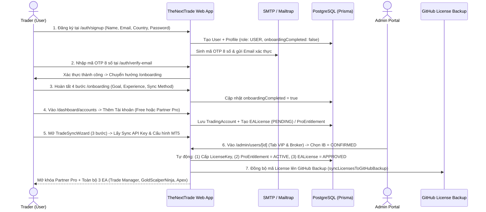
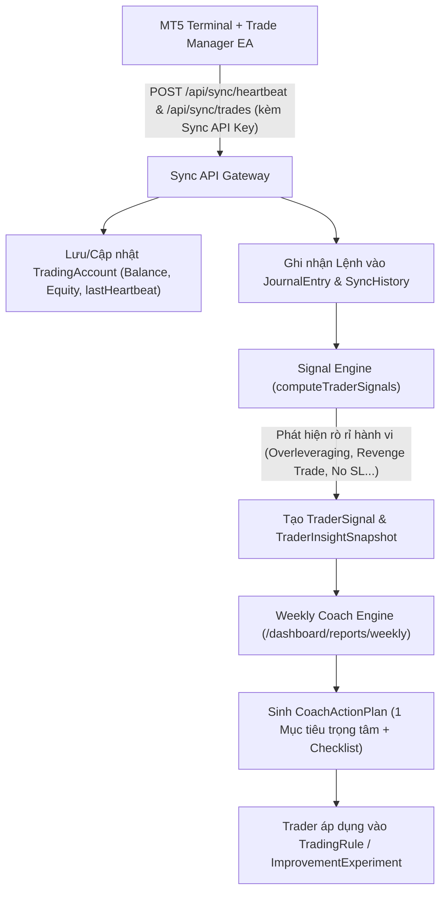
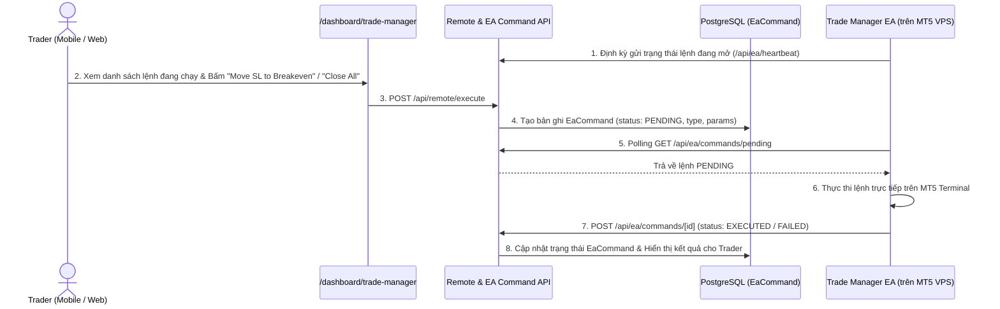

# TÀI LIỆU ĐẶC TẢ NGHIỆP VỤ TỔNG THỂ (MASTER BA SPECIFICATION / SRS)
**Dự án:** TheNextTrade (Hệ sinh thái Quản trị Giao dịch, Phân tích Hành vi & Tự động hóa MT5 — GoldScalperNinja Ecosystem)  
**Phiên bản:** 3.0 (Full System Specification — User to Admin)  
**Cập nhật lần cuối:** 2026-10-26  
**Stack công nghệ:** Next.js 15 (App Router), React 19, TypeScript, Tailwind CSS v4, Prisma ORM (PostgreSQL / Supabase), Supabase Auth, Nodemailer (SMTP/Mailtrap), OpenRouter AI Gateway.

---

## MỤC LỤC
1. [Phần 1: Tổng quan Hệ thống & Mô hình Kinh doanh (Business Overview & RBAC)](#phần-1-tổng-quan-hệ-thống--mô-hình-kinh-doanh-business-overview--rbac)
2. [Phần 2: Phân hệ Public & Acquisition (Khách vãng lai & Chuyển đổi)](#phần-2-phân-hệ-public--acquisition-khách-vãng-lai--chuyển-đổi)
3. [Phần 3: Phân hệ Xác thực, Bảo mật & Onboarding (Auth & Activation)](#phần-3-phân-hệ-xác-thực-bảo-mật--onboarding-auth--activation)
4. [Phần 4: Phân hệ Quản lý Tài khoản Giao dịch & Đồng bộ (Account Hub & Sync)](#phần-4-phân-hệ-quản-lý-tài-khoản-giao-dịch--đồng-bộ-account-hub--sync)
5. [Phần 5: Phân hệ Nhật ký Giao dịch, Phân tích & AI Coaching (Core Trading Loop)](#phần-5-phân-hệ-nhật-ký-giao-dịch-phân-tích--ai-coaching-core-trading-loop)
6. [Phần 6: Phân hệ Hệ sinh thái EA, Trade Manager Remote & MT5 Cloud Sync](#phần-6-phân-hệ-hệ-sinh-thái-ea-trade-manager-remote--mt5-cloud-sync)
7. [Phần 7: Phân hệ Học viện, Gamification & Giữ chân Người dùng (Academy & Retention)](#phần-7-phân-hệ-học-viện-gamification--giữ-chân-người-dùng-academy--retention)
8. [Phần 8: Phân hệ Quản trị Hệ thống — Admin Portal (Toàn bộ Modules)](#phần-8-phân-hệ-quản-trị-hệ-thống--admin-portal-toàn-bộ-modules)
9. [Phần 9: Sơ đồ Luồng Nghiệp vụ Trọng yếu (End-to-End Business Workflows)](#phần-9-sơ-đồ-luồng-nghiệp-vụ-trọng-yếu-end-to-end-business-workflows)
10. [Phần 10: Danh mục API, Cron Jobs & Kiến trúc Dữ liệu (Technical & Data Appendix)](#phần-10-danh-mục-api-cron-jobs--kiến-trúc-dữ-liệu-technical--data-appendix)

---

## PHẦN 1: TỔNG QUAN HỆ THỐNG & MÔ HÌNH KINH DOANH (BUSINESS OVERVIEW & RBAC)

### 1.1. Mục tiêu Sản phẩm (Product Vision)
**TheNextTrade** là hệ điều hành giao dịch (Trading Operating System) dành cho nhà giao dịch Forex/Gold (đặc biệt trên nền tảng MetaTrader 5). Hệ thống kết nối trực tiếp dữ liệu thực thi lệnh từ MT5 thông qua **Trade Manager EA** (hoặc ghi chép thủ công qua **Manual Journal**), phân tích rò rỉ hành vi (behavioral leaks), kiểm soát rủi ro và chuyển hóa thành **một kế hoạch hành động cụ thể mỗi tuần (Weekly Coach Action Plan)**.

- **Thương hiệu nền tảng (Global Platform Brand):** `TheNextTrade`
- **Thương hiệu Cộng đồng & Hệ thống EA (Community & EA Ecosystem Brand):** `GoldScalperNinja`

### 1.2. Mô hình Kinh doanh & Doanh thu (IB Rebate Business Model)
Khác với các phần mềm SaaS thu phí thuê bao tháng, **TheNextTrade miễn phí 100% ($0) cho Trader**:
- **Nguồn thu chính:** Hoa hồng IB (Introducing Broker Rebate / Commission per lot) từ các sàn đối tác chiến lược (**Exness, Vantage Markets, VT Markets, Ultima Markets**).
- **Cơ chế Mở khóa Đặc quyền (Partner Pro & EA Unlock):**
  - Khi Trader mở tài khoản giao dịch thực (Live Account) dưới mã IB của hệ thống và được Admin xác thực (`ibAttribution = CONFIRMED`), tài khoản đó tự động được nâng cấp lên **Partner Pro (`ProEntitlement = ACTIVE`)** và được cấp **1 License Key duy nhất mở khóa toàn bộ 3 sản phẩm EA** (`Trade Manager EA`, `GoldScalperNinja EA`, `GSN - Apex Gold Sentinel`).
  - Đối với tài khoản ngoài IB hoặc tài khoản Free, người dùng được cấp quyền dùng thử (**14-day Trial**) hoặc giới hạn ở gói **Free Tier** (vẫn sử dụng được nhật ký và đồng bộ cơ bản trên 1 tài khoản).

### 1.3. Vòng lặp Giá trị Cốt lõi (Core Product Loop)
```
[Đăng ký & Onboarding]
       ↓
[Kết nối Tài khoản MT5 qua Trade Manager EA / Ghi lệnh Manual]
       ↓
[Tự động Đồng bộ Lệnh & Telemetry (Balance, Equity, SL/TP, Tâm lý)]
       ↓
[Phân tích Hành vi (Analytics, Sessions, Mistakes, Trader Signals)]
       ↓
[AI Coach & Báo cáo Tuần (1 Kế hoạch Hành động / Thử nghiệm Kỷ luật)]
       ↓
[Tuân thủ Quy tắc (Rules/Goals) + Học tập (Academy) + Nhiệm vụ (Edge Missions)]
```

### 1.4. Ma trận Phân quyền Người dùng (Role-Based Access Control — RBAC)

| Vai trò (Role / Tier) | Định nghĩa trong DB | Quyền hạn chính |
| :--- | :--- | :--- |
| **Anonymous (Khách)** | Chưa đăng nhập | Xem trang chủ, đọc bài viết (`/articles`), xem khóa học (`/academy`), dùng 16 công cụ tính toán (`/tools/*`), làm trắc nghiệm tâm lý (`/trading-style`), xem hồ sơ công khai (`/trader/[username]`, `/share/[id]`). |
| **Free Trader (`USER`)** | `Profile.role = USER`, chưa có `ProEntitlement` ACTIVE | Quản lý 1 tài khoản giao dịch chính, đồng bộ qua Trade Manager EA hoặc ghi lệnh thủ công, xem Dashboard, Journal, Rules, Academy, Missions. Giới hạn một số tính năng nâng cao (Multi-account không giới hạn, AI Deep Intelligence, toàn bộ bộ 3 EA tự động). |
| **Partner Pro / VIP Trader** | `Profile.role = USER` + `ProEntitlement.status = ACTIVE` (hoặc `User.isVip = true`) | Kết nối không giới hạn tài khoản MT5, mở khóa toàn bộ 3 hệ thống EA (Trade Manager, GoldScalperNinja, Apex Gold Sentinel), truy cập đầy đủ AI Intelligence, Coaching chuyên sâu và Loyalty Rewards. |
| **Editor / Instructor** | `Profile.role = EDITOR` hoặc `INSTRUCTOR` | Quyền biên tập nội dung bài viết (`/admin/articles`) và học liệu Academy (`/admin/academy`). |
| **Administrator (`ADMIN`)** | `Profile.role = ADMIN` | Toàn quyền truy cập `/admin/*`: Quản lý User, Impersonate Trader, duyệt IB/VIP, cấp/thu hồi EA License, cấu hình Commission Rate, vận hành MT5 Cloud Worker, AI Gateway, Email Lab, Security Logs. |

---

## PHẦN 2: PHÂN HỆ PUBLIC & ACQUISITION (KHÁCH VÃNG LAI & CHUYỂN ĐỔI)

### 2.1. Trang chủ & Các trang Giới thiệu (`/`, `/get-started`, `/about`, `/edge`, `/faq`, `/contact`, `/legal/*`)
| Route | Tên chức năng | Đặc tả Nghiệp vụ (Business Rules & UI Behavior) |
| :--- | :--- | :--- |
| `/` | Homepage | Trình bày định vị hệ điều hành giao dịch thực chiến, minh chứng độ tin cậy (Reviews từ cộng đồng Telegram), giới thiệu vòng lặp cải thiện giao dịch, hệ thống EA và đối tác sàn. Tuyệt đối không hiển thị số liệu tổng ảo và không chứa mục Prop Firm. |
| `/get-started` | Bắt đầu nhanh (Launchpad) | - **Nếu chưa đăng nhập:** Hiển thị lộ trình 4 bước từ đăng ký đến phân tích lệnh đầu tiên kèm CTA `/auth/signup`.<br>- **Nếu đã đăng nhập:** Tự động biến thành bảng **Personalized Launch Checklist** kiểm tra tiến độ thực tế (Đã tạo tài khoản MT5 chưa? Đã đồng bộ lệnh chưa? Đã xem báo cáo chưa?). |
| `/about`, `/edge`, `/faq` | Giới thiệu & Giải đáp | Giải thích triết lý bảo toàn vốn ("Capital preservation first"), cơ chế điểm kỷ luật **Edge Score**, và các câu hỏi thường gặp về mô hình miễn phí qua IB. |
| `/contact` | Liên hệ hỗ trợ | Form gửi tin nhắn liên hệ lưu trực tiếp vào bảng `ContactMessage` để Admin xử lý tại `/admin/messages`. |
| `/legal/*` | Pháp lý | Gồm `/legal/privacy-policy`, `/legal/terms-of-service`, `/legal/cookie-policy`. Truy cập công khai không cần đăng nhập. |

### 2.2. Trắc nghiệm Phong cách Giao dịch — Trading Style Assessment (`/trading-style`)
- **Mục đích:** Công cụ chẩn đoán tâm lý và hành vi giao dịch giúp thu hút khách hàng tiềm năng (Lead Magnet) và cá nhân hóa lộ trình huấn luyện.
- **Quy tắc Nghiệp vụ:**
  1. **Màn hình Chào mừng (Welcome Screen):** Luôn hiển thị đầu tiên (không tự động nhảy vào câu 1 khi F5).
  2. **Bộ 14 câu hỏi tình huống thực chiến:** Đánh giá trên **6 chiều tâm lý (Dimensions)**:
     - *Risk Tolerance (Khẩu vị rủi ro)*
     - *Decision Speed (Tốc độ ra quyết định)*
     - *Emotional Control (Kiểm soát cảm xúc)*
     - *Analytical Depth (Độ sâu phân tích)*
     - *Rule Adherence (Tuân thủ kỷ luật)*
     - *Adaptability (Khả năng thích ứng)*
  3. **Phân loại 8 Hình mẫu Giao dịch (8 Trading Archetypes):** Tự động tính điểm và xếp vào 1 trong 8 hình mẫu kèm phân tích điểm mạnh, điểm mù (blind spots) và khuyến nghị quy tắc bảo vệ vốn.
  4. **Lưu trữ & Chia sẻ:** Nếu người dùng đăng nhập (hoặc đăng ký ngay sau khi làm), kết quả được lưu vào `User.tradingStyleProfile` và có thể bật hiển thị trên trang **Public Trader Card**.

### 2.3. Cộng đồng GoldScalperNinja (`/community`)
- **Mục đích:** Trang giới thiệu cộng đồng Telegram thực chiến **GoldScalperNinja** nhằm chuyển đổi người dùng mở tài khoản IB và tham gia nhóm tín hiệu/thảo luận.
- **Tính năng chính:**
  - Hiển thị bài đăng thực tế theo 4 tab thị trường: **Forex, Crypto, Indices, Commodities** (mỗi tab 10 bài chọn lọc kèm nút **Shuffle/Randomizer**).
  - Hỗ trợ xem ảnh phóng to (**Media Lightbox**), thả cảm xúc tương tác (`/api/community/reactions`).
  - Khối hướng dẫn tham gia VIP qua mở tài khoản sàn đối tác.

### 2.4. Giới thiệu Hệ thống EA (`/trading-systems`, `/trading-systems/[slug]`)
- **Mục đích:** Trang catalog giới thiệu bộ 3 công cụ MT5 chủ lực:
  1. **Trade Manager EA:** Trợ lý quản lý lệnh, tính lot theo % rủi ro, chia TP, dời SL/Breakeven, điều khiển từ xa qua điện thoại và tự động đồng bộ lịch sử giao dịch.
  2. **GoldScalperNinja EA:** Hệ thống giao dịch vàng (XAUUSD) tự động với bộ lọc phiên và kiểm soát sụt giảm vốn (Drawdown Control).
  3. **GSN - Apex Gold Sentinel (Phoenix Grid):** Hệ thống giao dịch thuật toán nâng cao với cơ chế quản trị lưới thông minh và bảo vệ tài khoản cứng.
- **Quy tắc Nghiệp vụ:** Không hiển thị trình giả lập lợi nhuận ảo (fake backtest simulator); tập trung mô tả cơ chế hoạt động, thông số kiểm soát rủi ro, tài liệu hướng dẫn (PDF/Markdown) và lộ trình mở khóa miễn phí qua IB.

### 2.5. Danh mục Sàn Đối tác (`/brokers`)
- Hiển thị thông tin chi tiết các sàn đối tác chiến lược (**Exness, Vantage, VT Markets, Ultima Markets**), mức hoàn phí/ưu đãi, điều kiện giao dịch (Spread, Leverage, Nạp/Rút) và đường link đăng ký gắn mã IB chuẩn (`EABroker.affiliateUrl`, `ibCode`).

### 2.6. Bộ 16 Công cụ Tính toán Giao dịch & Lịch Kinh tế (`/tools`, `/tools/*`)
Phục vụ SEO tự nhiên và hỗ trợ tính toán rủi ro hàng ngày cho Trader (ghi nhận lượt dùng qua bảng `ToolView` và API `/api/tools/views`):
1. `/tools/position-size-calculator` — Tính khối lượng vào lệnh (Lot size) chuẩn xác theo % rủi ro và khoảng cách Stop Loss.
2. `/tools/pip-value-calculator` — Tính giá trị mỗi Pip theo cặp tiền và kích thước lệnh.
3. `/tools/margin-calculator` — Tính mức ký quỹ cần thiết theo đòn bẩy.
4. `/tools/profit-loss-calculator` — Ước tính Lãi/Lỗ theo giá mở, giá đóng và khối lượng.
5. `/tools/risk-reward-calculator` — Tính tỷ lệ R:R (Risk-to-Reward) và xác suất thắng hòa vốn (Breakeven Winrate).
6. `/tools/drawdown-calculator` — Tính mức sụt giảm tài khoản liên tiếp và phần trăm cần thiết để gỡ hòa vốn.
7. `/tools/compounding-calculator` — Bài toán lãi kép theo chu kỳ giao dịch.
8. `/tools/risk-of-ruin-calculator` — Tính xác suất cháy tài khoản (Risk of Ruin) dựa trên Winrate, Payoff Ratio và % Risk/lệnh.
9. `/tools/leverage-calculator` — Tính đòn bẩy thực tế (Effective Leverage).
10. `/tools/fibonacci-calculator` — Tính các mốc Fibonacci Retracement & Extension.
11. `/tools/pivot-point-calculator` — Tính các ngưỡng Pivot (Classic, Woodie, Camarilla, DeMark).
12. `/tools/correlation-matrix` — Ma trận tương quan giữa các cặp tiền và XAUUSD (`/api/tools/correlation`).
13. `/tools/currency-converter` — Chuyển đổi tiền tệ theo tỷ giá thời gian thực (`/api/tools/convert`).
14. `/tools/currency-heat-map` — Bản đồ nhiệt sức mạnh các đồng tiền chính.
15. `/tools/live-market-rates` & `/tools/market-hours` — Bảng giá trực tiếp (`/api/tools/rates`) & Đồng hồ 4 phiên giao dịch (Sydney, Tokyo, London, New York).
16. `/tools/economic-calendar` — Lịch tin tức kinh tế vĩ mô lấy từ DB `EconomicEvent` (đồng bộ định kỳ qua cron `/api/cron/sync-events`), lọc theo mức độ ảnh hưởng (Low, Medium, High) và đồng tiền.

### 2.7. Chuyên mục Bài viết, Kiến thức & Tìm kiếm (`/articles/*`, `/knowledge/*`, `/search`)
- **Articles (`/articles`, `/articles/[slug]`, `/articles/category/[slug]`, `/articles/tag/[slug]`):** Hệ thống Blog chuẩn SEO, hỗ trợ bình luận (`Comment`), bình chọn bài viết hữu ích (`ArticleVote`), ước tính thời gian đọc, mục lục tự động và gợi ý bài viết liên quan.
- **Knowledge Hub (`/knowledge`, `/knowledge/risk-management`):** Cổng tra cứu tài liệu chuyên đề quản trị rủi ro.
- **Tìm kiếm Toàn cục (`/search`, `/api/search`, `/api/ai/search`):** Tìm kiếm hợp nhất trên Bài viết, Bài học Academy và Công cụ.

### 2.8. Hồ sơ Giao dịch Công khai & Thẻ Chia sẻ Lệnh (`/trader/[username]`, `/share/[id]`, `/certificate/*`)
- **Public Trader Card (`/trader/[username]`):**
  - Hiển thị hồ sơ năng lực của Trader nếu họ bật công khai trong cài đặt (`Profile.publicProfileSettings`).
  - Hỗ trợ **3 chế độ bảo mật (Privacy Presets)**: ẩn/hiện số dư thực, chỉ hiện % tăng trưởng hoặc R-multiple, hiển thị huy hiệu hình mẫu tâm lý (`Trading Style Archetype`) và mức độ tin cậy của dữ liệu (Verified EA Sync vs Manual).
- **Share Trade Card (`/share/[id]`):** Trang chia sẻ chi tiết 1 lệnh giao dịch cụ thể với giao diện thẻ đồ họa chuyên nghiệp.
- **Chứng chỉ Học thuật (`/certificate/[id]`, `/certificate/master/[userId]`):** Trang xác thực chứng chỉ hoàn thành khóa học Academy có mã định danh duy nhất.

---

## PHẦN 3: PHÂN HỆ XÁC THỰC, BẢO MẬT & ONBOARDING (AUTH & ACTIVATION)

### 3.1. Đăng ký Tài khoản Đa bước (`/auth/signup`)
- **Luồng giao diện (2 bước gọn nhẹ):**
  - **Bước 1:** Nhập Họ tên, Email, Quốc gia (Country Picker tự động nhận diện qua `/api/geo/country`).
  - **Bước 2:** Tạo mật khẩu mạnh, đồng ý Điều khoản dịch vụ, kiểm tra Cloudflare Turnstile (chống bot) và mã giới thiệu (`referredBy` nếu có từ link affiliate/referral).
- **Xử lý Backend (`src/app/auth/actions.ts`):**
  - Tạo tài khoản trong Supabase Auth + khởi tạo bản ghi `User` và `Profile` trong PostgreSQL.
  - Nếu hệ thống cấu hình `SUPABASE_SERVICE_ROLE_KEY` và `SMTP_HOST`, hệ thống chủ động sinh mã OTP 8 chữ số qua `supabaseAdmin.auth.admin.generateLink({ type: "signup" })` và gửi email thương hiệu (`buildSignupOtpEmailHtml`) qua SMTP/Mailtrap, sau đó chuyển hướng sang `/auth/verify-email`.

### 3.2. Xác thực Email OTP (`/auth/verify-email`)
- Người dùng nhập mã **OTP 8 chữ số** nhận qua email.
- Hỗ trợ nút **Resend Code** (có đồng hồ đếm ngược chống spam).
- Sau khi xác thực thành công (`supabase.auth.verifyOtp`), hệ thống tự động dẫn người dùng mới vào `/onboarding`.

### 3.3. Đăng nhập, Quên mật khẩu & Xác thực 2 lớp (`/auth/login`, `/auth/forgot-password`, `/auth/update-password`, `/auth/verify-2fa`)
- **Đăng nhập (`/auth/login`):**
  - Kiểm tra thông tin đăng nhập qua Supabase Auth.
  - Ghi log bảo mật (`SecurityLog`: `LOGIN_SUCCESS` hoặc `LOGIN_FAILED` kèm IP và User-Agent).
  - Nếu tài khoản bật 2FA (`User.twoFactorEnabled = true`), chuyển hướng sang `/auth/verify-2fa` yêu cầu nhập mã TOTP 6 số từ ứng dụng Authenticator trước khi cấp quyền vào `/dashboard`.
- **Quên & Đặt lại mật khẩu (`/auth/forgot-password`, `/auth/update-password`):** Gửi link khôi phục mật khẩu qua email và cho phép cập nhật mật khẩu mới.

### 3.4. Khảo sát Định hướng Ban đầu — Onboarding 4 bước (`/onboarding`)
Dành riêng cho người dùng vừa kích hoạt tài khoản (`User.onboardingCompleted = false`):
1. **Bước 1 — Kinh nghiệm & Thị trường (Experience Level):** Chọn mức kinh nghiệm (Beginner, Intermediate, Advanced) và thị trường giao dịch chính.
2. **Bước 2 — Mục tiêu Giao dịch Chính (Primary Goal):** Chọn mục tiêu trọng tâm (Bảo vệ vốn, Sửa lỗi kỷ luật, Tự động hóa bằng EA, v.v.).
3. **Bước 3 — Phương thức Đồng bộ (Preferred Sync Method):** Chọn giữa **Trade Manager EA (Khuyên dùng cho MT5 Desktop/VPS)** hoặc **Manual Journal (Dành cho người dùng Mobile / chưa sẵn sàng cài EA)**.
4. **Bước 4 — Hoàn tất & Đi tới Hành động Đầu tiên:** Lưu cấu hình vào `User` (`experienceLevel`, `primaryGoal`, `preferredSyncMethod`, `onboardingCompleted = true`) và điều hướng thẳng tới bước thiết lập tương ứng.

### 3.5. Trợ lý Phiên Đầu tiên — First Session Wizard (`FirstSessionWizard.tsx`)
- Hiển thị trên `/dashboard` cho người dùng mới chưa hoàn tất thiết lập ban đầu.
- Gồm 3 bước kiểm tra tự động:
  1. **Add Trading Account:** Thêm tài khoản giao dịch đầu tiên.
  2. **Verify Trade Manager EA Sync (hoặc Log First Trade):** Kết nối EA đồng bộ hoặc ghi lệnh đầu tiên.
  3. **Review First Insight:** Xem thống kê phân tích đầu tiên trên Dashboard.
- Có cơ chế ẩn/bỏ qua thông minh để không làm phiền các Trader đã có dữ liệu giao dịch.

---

## PHẦN 4: PHÂN HỆ QUẢN LÝ TÀI KHOẢN GIAO DỊCH & ĐỒNG BỘ (ACCOUNT HUB & SYNC)

### 4.1. Trung tâm Quản lý Tài khoản (`/dashboard/accounts`)
- **Hiển thị danh sách tài khoản (`AccountListClient.tsx`):**
  - Trình bày thông số kỹ thuật theo chuẩn **2x2 Matrix Specs Card** (`Account #`, `Broker`, `Server`, `Platform`).
  - Hiển thị trạng thái kết nối thời gian thực bằng chấm xung nhịp (**Pulsing Green Dot**) kèm thời gian đồng bộ tương đối (`formatDistanceToNow(lastHeartbeat)`).
  - Hiển thị nhãn phân hạng rõ ràng: **Partner Pro (Verified IB)**, **Trial Active**, **Pending Verification**, hoặc **Free Tier**.
  - Cho phép đặt **Tài khoản Mặc định (`isDefault`)**, đổi tên/màu sắc nhận diện (Prefix Color Swatch), xem hoặc tạo lại License Key, và xóa tài khoản.

### 4.2. Luồng Thêm Tài khoản Mới (`AddAccountModal.tsx`)
Khi bấm **Add Account**, người dùng chọn 1 trong 2 phân luồng:
1. **Luồng 1 — Free Account (Tài khoản Miễn phí / Sàn bất kỳ):**
   - Nhập Tên gợi nhớ (kèm chọn màu Swatch), Nền tảng (`MT5` / `MT4` / `cTrader`), Tên sàn (`Broker`), Số tài khoản (`Account Number`), Tiền tệ (`USD`, `EUR`, v.v.) và Số dư ban đầu (`Initial Balance`).
   - Sau khi tạo xong, hệ thống tự động mở **TradeSyncWizard** để hướng dẫn kết nối đồng bộ (hoặc cho phép bấm **Skip for now**).
2. **Luồng 2 — Partner Pro Account (Mở khóa VIP & Toàn bộ 3 EA miễn phí):**
   - Chọn sàn đối tác (**Exness, Vantage, VT Markets, Ultima Markets**).
   - Nếu chưa có tài khoản dưới IB: hiển thị hướng dẫn mở tài khoản mới qua link IB hoặc chuyển đổi mã IB (IB Transfer), kèm thông tin điều kiện tối thiểu.
   - Nhập Số tài khoản MT5 để gửi yêu cầu xác thực (`ProEntitlement` / `EALicense` ở trạng thái chờ duyệt hoặc kích hoạt dùng thử 14 ngày nếu đủ điều kiện).

### 4.3. Trình Hướng dẫn Đồng bộ 3 bước — TradeSyncWizard (`TradeSyncWizard.tsx`)
Được tinh gọn thành **3 bước trực tiếp**:
- **Step 1 — Sync API Key & Registered Accounts:**
  - Hiển thị hoặc khởi tạo mới **Sync API Key** 64 ký tự (`User.syncApiKey`) kèm nút **Copy Key** 1-click.
  - Liệt kê các tài khoản MT5 đã đăng ký và nút tải xuống file `GoldScalperNinja_Sync.ex5` / `TradeManager.ex5`.
  - Nếu truy cập từ điện thoại (`useIsMobileSyncDevice`), hiển thị cảnh báo thân thiện kèm nút **Email Desktop Setup Link** (gửi link cài đặt về email để mở trên PC/VPS) hoặc **Log Manually instead**.
- **Step 2 — Step-by-Step MetaTrader 5 Setup:**
  - Hướng dẫn chi tiết 4 thao tác trong MT5:
    1. Mở **Tools → Options (`Ctrl + O`) → Expert Advisors**.
    2. Tick chọn **"Allow WebRequest for listed URL"** và dán URL Server (lấy từ biến môi trường `NEXT_PUBLIC_SYNC_SERVER_URL || NEXT_PUBLIC_APP_URL` qua `getSyncServerUrl()`) kèm nút **Copy URL** 1-click.
    3. Bật nút **Algo Trading** (màu xanh) và kéo thả **Trade Manager EA** vào biểu đồ.
    4. Mở tab **SYNC** trên bảng điều khiển EA, dán **Sync API Key** và bấm **Connect**.
- **Step 3 — Verify Connection:**
  - Kiểm tra tự động 4 tiêu chí qua `/api/sync/status`:
    - `API key generated`
    - `MT5 account registered`
    - `Heartbeat detected`
    - `Trades synced`
  - Tích hợp bảng **SyncTroubleshootingPanel** giúp xử lý các lỗi thường gặp (chưa bật Algo Trading, sai URL WebRequest, sai số tài khoản).

### 4.4. Trung tâm Sức khỏe Đồng bộ & Hỗ trợ Cloud Sync (`SyncHealthCenter` & `/dashboard/settings/sync-settings`)
- Theo dõi lịch sử đồng bộ (`SyncHistory`), thời점 heartbeat cuối cùng, số lệnh đã đồng bộ và phiên bản EA đang chạy (`eaVersion`).
- Nếu người dùng gặp khó khăn khi tự cài đặt EA trên VPS/PC, họ có thể gửi yêu cầu hỗ trợ đồng bộ (`SupportSyncTicket`) để Admin kiểm tra tại `/admin/ib/sync-requests`.

---

## PHẦN 5: PHÂN HỆ NHẬT KÝ GIAO DỊCH, PHÂN TÍCH & AI COACHING (CORE TRADING LOOP)

### 5.1. Bảng điều khiển Tổng quan (`/dashboard`)
- **Hiển thị thích ứng theo trạng thái dữ liệu (Context-Aware Visibility):**
  - **Chưa có lệnh:** Ẩn toàn bộ bộ lọc rỗng và biểu đồ trống; chỉ hiển thị **First Session Wizard** và lời nhắc kết nối MT5 hoặc ghi lệnh đầu tiên.
  - **Đã có dữ liệu giao dịch:**
    - Dãy thẻ KPI cốt lõi: **Net P&L, Win Rate, Profit Factor, Expectancy, Average R:R, Max Drawdown**.
    - Biểu đồ **Equity Curve** và **Lịch Lãi/Lỗ theo Ngày (Monthly PnL Calendar)**.
    - Khối **One Next Action / Active Coach Plan:** Hiển thị duy nhất 1 hành động ưu tiên cao nhất trong tuần để Trader tập trung khắc phục.

### 5.2. Nhật ký Giao dịch Chi tiết (`/dashboard/journal`)
- **Danh sách & Bộ lọc Lệnh:**
  - Lọc theo Tài khoản giao dịch (Account Switcher), Khoảng thời gian, Cặp tiền (`Symbol`), Chiều lệnh (`BUY`/`SELL`), Kết quả (`WIN`/`LOSS`/`BREAKEVEN`), Chiến lược (`Strategy`), và Sai lầm (`Mistakes`).
- **Chi tiết từng Lệnh (`JournalEntry`):**
  - Thông số thực thi: Giá mở (`entryPrice`), Giá đóng (`exitPrice`), Stop Loss (`stopLoss`), Take Profit (`takeProfit`), Khối lượng (`lotSize`), Phí (`commission`), Qua đêm (`swap`), Lãi/Lỗ ròng (`pnl`), MAE / MFE (`maxAdverseExcursion`, `maxFavorableExcursion`).
  - Ngữ cảnh & Tâm lý: Chiến lược áp dụng (`strategy`), Mức tự tin (`confidenceLevel` 1-5), Cảm xúc trước/sau lệnh (`emotionBefore`, `emotionAfter`), Sai lầm mắc phải (`mistakes[]`), Ghi chú tâm lý (`notesPsychology`) và Ảnh chụp màn hình biểu đồ (`images[]`).
  - Ghi chú theo Ngày giao dịch (`TradingDayNote`): Lưu nhận định tổng kết mỗi ngày.
- **Nhập/Xuất Dữ liệu:**
  - Hỗ trợ ghi lệnh thủ công (**Log Trade Modal**).
  - Hỗ trợ Import file lịch sử CSV/HTML từ MT4/MT5 (`/api/import/parse`, `/api/import/execute`).
  - Hỗ trợ Export dữ liệu ra CSV/JSON (`/api/export/csv`, `/api/export/json`).

### 5.3. Phân tích Phiên & Sai lầm (`/dashboard/sessions`, `/dashboard/analytics`)
- **Phân tích theo Phiên (`/dashboard/sessions`):** Bóc tách hiệu suất theo 4 phiên giao dịch (**Asian, London, Overlap, New York**) để phát hiện phiên nào Trader có lợi thế (Positive Edge) và phiên nào hay mất tiền nhất.
- **Phân tích Đa chiều (`/dashboard/analytics`):**
  - Hiệu suất theo Cặp tiền (`Symbol Breakdown`), Thứ trong tuần (`Day of Week`), Giờ vào lệnh (`Hour of Day`), Thời gian giữ lệnh (`Holding Duration`).
  - Phân tích Rò rỉ Hành vi (**Behavioral Leak Radar**): Thống kê thiệt hại bằng tiền mặt do các lỗi kỷ luật gây ra (Revenge Trading, FOMO, Dời Stop Loss, Vào lệnh quá khối lượng).

### 5.4. Trung tâm Trí tuệ Nhân tạo — AI Intelligence (`/dashboard/intelligence`)
- Khi người dùng bấm phân tích, yêu cầu được gửi qua **Internal AI Gateway (`/api/v1/ai/analyze`)** (tuyệt đối không gọi trực tiếp từ trình duyệt ra OpenRouter).
- Hệ thống tổng hợp lịch sử lệnh, tín hiệu hành vi (`TraderSignal`) và tạo bản phân tích ngắn gọn chỉ rõ:
  1. Rủi ro lớn nhất đang đe dọa vốn.
  2. Điểm mạnh đang tạo lợi nhuận ổn định.
  3. Một quy tắc hành động cụ thể cần áp dụng trong 10 lệnh tiếp theo (**10-Trade Sprint**).

### 5.5. Báo cáo Định kỳ & Huấn luyện viên Tuần (`/dashboard/reports`, `/dashboard/reports/weekly`, `/dashboard/reports/monthly`)
- **Signal Engine (`src/lib/coach/signal-engine.server.ts`):** Tự động quét lịch sử lệnh để phát hiện các tín hiệu hành vi (`TraderSignal`: ví dụ thua liên tiếp buổi tối, gồng lỗ gấp 3 lần chốt lời, nhồi lệnh sau khi thua).
- **Weekly Coach Action Plan (`CoachActionPlan` & `CoachActionPlanItem`):**
  - Gồm 3 phần rõ ràng: **Keep Doing** (Phát huy lợi thế), **Fix Next** (Điểm rò rỉ cần khóa lại ngay), và **Action Checklist** (Danh sách việc cần làm trong tuần).
- **Thử nghiệm Cải thiện (`ImprovementExperiment`):**
  - Cho phép Trader khởi tạo một thử nghiệm kỷ luật kéo dài 7–14 ngày (ví dụ: *"Không vào lệnh sau 22:00"* hoặc *"Cắt giảm 50% lot sau 2 lệnh thua liên tiếp"*).
  - Sau khi hoàn thành thành công, thử nghiệm có thể được nâng cấp thành **Quy tắc Cứng (`TradingRule`)**.

### 5.6. Bộ Quy tắc, Mục tiêu & Chiến lược (`/dashboard/rules`, `/dashboard/strategies`)
- **Rulebook & Goals (`/dashboard/rules`):**
  - Quản lý các quy tắc giao dịch cá nhân (`TradingRule`: phân loại theo Risk, Entry, Exit, Psychology, Session).
  - Đặt mục tiêu định량 (`TraderGoal`: giới hạn lỗ ngày, số lệnh tối đa/ngày, tỷ lệ tuân thủ quy tắc).
  - Kiểm tra tuân thủ quy tắc trên từng kế hoạch giao dịch (`TradePlan` & `TradeRuleCheck`).
- **Quản lý Chiến lược (`/dashboard/strategies`):**
  - Định nghĩa các Playbook/Setup giao dịch (`Strategy`), gắn thẻ vào các lệnh trong Journal và đo lường Winrate / Profit Factor riêng cho từng chiến lược (`/api/strategies/performance`).

---

## PHẦN 6: PHÂN HỆ HỆ SINH THÁI EA, TRADE MANAGER REMOTE & MT5 CLOUD SYNC

### 6.1. Quản lý Tải xuống & Bản quyền EA (`/dashboard/trading-systems`)
- Hiển thị danh sách 3 sản phẩm EA chính thức từ bảng `EAProduct`.
- **Cơ chế Cấp phép Hợp nhất (Unified Single License Key):**
  - Mỗi tài khoản MT5 được duyệt (`EALicense.status = APPROVED` hoặc `ProEntitlement.status = ACTIVE`) sẽ có một mã `licenseKey` gắn liền với cặp `(broker, accountNumber)`.
  - **1 License Key mở khóa cả 3 EA** (Trade Manager, GoldScalperNinja, Apex Gold Sentinel).
- **Cơ chế Xác thực Bản quyền Đa tầng (Dual Verification):**
  1. **Primary API (`/api/ea/license/verify`):** EA trên MT5 gọi về server kiểm tra trạng thái bản quyền và ghi nhận sự kiện sử dụng (`EAProductUsageEvent`).
  2. **GitHub Backup Sync (`src/lib/ea/github-license-sync.server.ts`):** Mỗi khi Admin duyệt/thu hồi bản quyền hoặc qua cron `/api/cron/license-github-sync`, hệ thống tự động đồng bộ danh sách tài khoản hợp lệ lên kho lưu trữ dự phòng GitHub (`LicenseGitHubSyncJob`) để EA vẫn hoạt động ổn định ngay cả khi server web bảo trì.

### 6.2. Điều khiển Trade Manager Từ xa qua Web/Mobile (`/dashboard/trade-manager`)
- **Mục đích:** Giúp Trader theo dõi và điều khiển nhanh các vị thế đang mở trên MT5 ngay từ trình duyệt điện thoại hoặc máy tính mà không cần mở Remote Desktop vào VPS.
- **Kiến trúc Hoạt động (`/api/remote/*` ↔ `/api/ea/commands/*`):**
  - **Telemetry chiều lên (`/api/ea/heartbeat`, `/api/remote/state`):** Trade Manager EA trên MT5 gửi trạng thái tài khoản, danh sách lệnh đang mở, mức P&L nổi (floating P&L) và cấu hình bảo vệ tài khoản lên server.
  - **Lệnh điều khiển chiều xuống (`/api/remote/execute` → `EaCommand` → `/api/ea/commands/pending`):**
    - Người dùng bấm lệnh trên giao diện `/dashboard/trade-manager` (ví dụ: **Close All Positions, Close Profitable, Close Losing, Move SL to Breakeven, Partial Close %**).
    - Server tạo bản ghi `EaCommand` với trạng thái `PENDING`.
    - Trade Manager EA trên MT5 nhận lệnh trong chu kỳ polling tiếp theo, thực thi trên MT5 và báo cáo kết quả (`EXECUTED` / `FAILED`) về `/api/ea/commands/[id]`.
  - Hỗ trợ cấu hình quy tắc bảo vệ từ xa (`/api/remote/rules`) và cảnh báo qua Telegram (`/api/remote/telegram`).

### 6.3. Kiến trúc Đồng bộ Đám mây — MT5 Cloud Worker (`Mt5Worker` & `/api/worker/*`)
Dành cho tính năng đồng bộ đám mây tự động:
- **Quản lý Worker (`Mt5Worker`):** Các máy chủ Windows Worker đăng ký với hệ thống qua token (`Mt5EnrollmentToken`), hỗ trợ chạy đa tiến trình (**Multi-Instance MT5 Terminal**) và cơ chế **Smart Auto-Sleep** (tự động ngủ khi không có lịch đồng bộ để tiết kiệm RAM/CPU).
- **Bảo mật Thông tin Đăng nhập (`TradingAccountCredential`):** Mật khẩu Investor (Read-only password) được mã hóa AES-256-GCM (`secretCiphertext`, `iv`, `authTag`). Mọi thao tác giải mã xem thông tin bởi Admin đều bắt buộc ghi vết vào `AdminAuditLog` (`ADMIN_VIEW_CREDENTIAL`).
- **Luồng Job Đồng bộ (`/api/worker/jobs/pull`, `/api/worker/jobs/submit`, `/api/worker/jobs/fail`):** Worker nhận `Mt5ImportJob`, đăng nhập MT5 lấy lịch sử `Mt5RawOrder` & `Mt5RawDeal`, sau đó chuẩn hóa thành `JournalEntry`.

---

## PHẦN 7: PHÂN HỆ HỌC VIỆN, GAMIFICATION & GIỮ CHÂN NGƯỜI DÙNG (ACADEMY & RETENTION)

### 7.1. Học viện Giao dịch — Trading Academy (`/academy`, `/dashboard/academy`)
- **Cấu trúc Học liệu 4 tầng:**
  `Level (Cấp độ 1 → 4)` ➔ `Module (Học phần)` ➔ `Lesson (Bài học)` + `Quiz (Bài kiểm tra cuối học phần)`.
- **Trải nghiệm Học tập (`/academy/lesson/[slug]`, `/dashboard/academy/lessons/[slug]`):**
  - Nội dung bài học giàu trực quan (sơ đồ minh họa, hộp cảnh báo rủi ro, ví dụ thực tế).
  - Theo dõi tiến độ từng bài học (`UserProgress.isCompleted`).
  - Làm bài kiểm tra trắc nghiệm (`Quiz` → `Question` → `Option`), chấm điểm tự động qua `/api/quizzes/[id]/submit` và lưu lịch sử `UserQuizAttempt`.
  - Khi hoàn thành toàn bộ một Level hoặc toàn khóa, hệ thống cấp **Chứng chỉ (`Certificate`)** có thể tải về hoặc chia sẻ công khai.

### 7.2. Nhiệm vụ Kỷ luật, Chuỗi Ngày & Điểm Edge (`/dashboard/learning`, `/dashboard/settings/streak`)
- **Hệ thống Điểm Edge (`EdgeEvent` & `UserMissionProgress`):**
  - Điểm thưởng trong hệ thống được gọi thống nhất là **Edge** (thay cho XP truyền thống), phản ánh mức độ rèn luyện kỷ luật.
  - Các nhiệm vụ hàng ngày/tuần: Điểm danh mỗi ngày (**Daily Check-in** qua `/api/streak/check-in`), ghi nhật ký đầy đủ cảm xúc, hoàn thành bài học Academy, tuân thủ quy tắc rủi ro.
- **Chuỗi Ngày Kỷ luật (`User.streak`, `longestStreak`, `freezeCount`):**
  - Duy trì chuỗi ngày hoạt động liên tục; hỗ trợ vật phẩm **Streak Freeze** để bảo vệ chuỗi ngày khi nghỉ giao dịch.

### 7.3. Bảng Xếp hạng, Khách hàng Thân thiết & Giới thiệu (`/dashboard/leaderboard`, `/dashboard/loyalty`, `/dashboard/settings/referrals`)
- **Leaderboard (`/dashboard/leaderboard`):** Xếp hạng các Trader theo tính kỷ luật, điểm Edge và hiệu suất ổn định (chỉ hiển thị các tài khoản chọn tham gia bảng xếp hạng `TradingAccount.showOnLeaderboard = true`).
- **Loyalty Program (`/dashboard/loyalty`):** Tích lũy khối lượng giao dịch qua IB (`LoyaltyTier`) để đổi các phần thưởng/đặc quyền (`LoyaltyClaim`: VPS miễn phí, Coaching 1-1, quà tặng độc quyền).
- **Chương trình Giới thiệu (`/dashboard/settings/referrals`):** Mỗi người dùng có mã `referralCode` riêng để mời bạn bè tham gia hệ sinh thái và theo dõi danh sách người được giới thiệu.

---

## PHẦN 8: PHÂN HỆ QUẢN TRỊ HỆ THỐNG — ADMIN PORTAL (TOÀN BỘ MODULES)

Toàn bộ các trang `/admin/*` được bảo vệ bởi Middleware và hàm `requireAdminPageAccess()` (kiểm tra `Profile.role === "ADMIN"`). Đăng nhập quản trị có cổng riêng tại `/admin/login`.

### 8.1. Bảng Điều hành Tổng quan & Báo cáo Vận hành (`/admin`, `/admin/reports`, `/admin/analytics`, `/admin/release-health`)
| Route | Chức năng Quản trị | Đặc tả chi tiết |
| :--- | :--- | :--- |
| `/admin` | Admin Dashboard | Thống kê nhanh số lượng User mới, tài khoản chờ duyệt, lệnh mới đồng bộ, cảnh báo hệ thống và các tác vụ cần xử lý ngay (`PendingActionsWidget`). |
| `/admin/reports` | Owner Operating Cockpit | Báo cáo phễu kích hoạt người dùng (**Activation Funnel**: Signup → Onboarded → Added Account → First Sync → Active), danh sách **Stuck Users** (người dùng bị kẹt ở bước cài đặt) để đội ngũ hỗ trợ chủ động liên hệ. |
| `/admin/analytics` | Phân tích Lưu lượng (Web Analytics) | Thống kê lượt truy cập (`PageView`, `AnalyticsEvent`), bản đồ quốc gia (WorldMap), nguồn giới thiệu (Referrers), hiệu quả chiến dịch UTM (`CampaignPanel`) và hiệu quả nội dung bài viết (`ContentAnalyticsPanel`). |
| `/admin/release-health` | Sức khỏe Phiên bản & Hệ thống | Kiểm tra trạng thái kết nối DB, Cron jobs, tỷ lệ lỗi đồng bộ và sức khỏe các dịch vụ nền. |

### 8.2. Quản trị Người dùng & CRM Chuyên sâu (`/admin/users`, `/admin/users/behavior`, `/admin/users/[id]`)

#### A. Danh sách Người dùng (`/admin/users`)
- Tìm kiếm theo Tên, Email, ID; lọc theo Role (`USER`, `ADMIN`, `EDITOR`, `INSTRUCTOR`), Quốc gia và Trạng thái.
- Thao tác nhanh trên từng dòng (`UserRowActions.tsx`):
  - **View Profile:** Đi tới trang CRM chi tiết `/admin/users/[id]`.
  - **Impersonate Trader (`impersonateUserAction`):** Đăng nhập vào giao diện `/dashboard` dưới góc nhìn của Trader đó (lưu cookie `impersonate_user_id` trong 2 giờ và ghi `AuditLog: IMPERSONATE_USER_START`) để kiểm tra và hỗ trợ trực tiếp.
  - **Change Role:** Thay đổi quyền hạn người dùng.
  - **Reset Password:** Gửi email khôi phục mật khẩu thương hiệu cho người dùng.
  - **Delete User:** Xóa tài khoản (kèm hộp thoại xác nhận).
- Hỗ trợ tạo người dùng mới (`AddUserModal`) và xuất danh sách CSV.

#### B. Phân khúc Hành vi Người dùng (`/admin/users/behavior`)
- Tự động phân loại toàn bộ cơ sở người dùng (`classifyUser` trong `src/lib/admin/behavior/classify.server.ts`) thành 2 nhóm hành động:
  1. **Needs Attention (Cần hỗ trợ ngay):** Người dùng bị lỗi đồng bộ EA, đang chịu chuỗi thua lớn (High Drawdown), hoặc bỏ dở quá trình cài đặt.
  2. **Value Radar (Giá trị cao / Tiềm năng IB):** Các Trader có tổng vốn thực lớn, tần suất giao dịch cao, hoặc đang dùng thử sắp hết hạn cần chăm sóc chuyển đổi lên Partner Pro.

#### C. Hồ sơ CRM Chi tiết của 1 User (`/admin/users/[id]`)
Được thiết kế theo kiến trúc CRM mật độ cao gồm:
- **Cột trái (Identity & Quick Actions):**
  - Thông tin định danh, Quốc gia, Ngày tham gia, Tổng vốn thực (**Real Capital Breakdown** tách bạch rõ tài khoản Live và Demo), `UserNarrativeSummary` (tóm tắt tự động trạng thái của Trader).
  - **Quick Actions:** Đổi Role, Gửi email Reset Password, Gửi thông báo trực tiếp (`sendUserNotification`).
  - **Admin Notes:** Ghi chú nội bộ của Admin về Trader này (tự động lưu).
- **Cột phải — 3 Tab Nghiệp vụ chuyên sâu (`UserDetailTabsWrapper.tsx`):**
  1. **Tab 1: `Overview` (`UserOverviewTab.tsx`):** Tổng quan hoạt động, danh sách tài khoản giao dịch, tiến độ học tập Academy, huy hiệu và dòng thời gian hoạt động.
  2. **Tab 2: `VIP & Broker` (`UserVipProTab.tsx`):**
     - Quản lý trạng thái **VIP / Partner Pro** của User (Nút bật/tắt VIP trực tiếp hoặc gia hạn Trial).
     - Bảng **IB Attribution & All-EA Access** cho từng tài khoản MT5:
       - Khi Admin chọn **`CONFIRMED (Under Our IB)`** (`updateTradingAccountIbAttribution`): Hệ thống **tự động thực hiện chuỗi 4 tác vụ đồng bộ**:
         1. Cấp/kích hoạt `TradingAccount.licenseKey`.
         2. Tạo/cập nhật `ProEntitlement` sang `ACTIVE` (`IB_VERIFIED`).
         3. Tạo/cập nhật `EALicense` sang `APPROVED` (mở khóa toàn bộ 3 EA).
         4. Đẩy bản cập nhật lên GitHub Backup (`syncLicensesToGitHubBackup`).
       - Khi Admin chọn **`NOT_OURS (External)`**: Tự động đình chỉ `EALicense` (`SUSPENDED`) và thu hồi `ProEntitlement` nguồn IB.
     - Theo dõi lịch sử tải xuống EA (`EADownload`) và nhật ký sử dụng EA (`EAProductUsageEvent`).
  3. **Tab 3: `Coaching & Analytics` (`UserCoachingAnalyticsTab.tsx`):**
     - Xem điểm kỷ luật, các tín hiệu rủi ro (`TraderSignal`), kế hoạch huấn luyện tuần hiện tại (`CoachActionPlan`) và toàn bộ lịch sử lệnh giao dịch của User để đội ngũ Coach tư vấn sát thực tế.

### 8.3. Quản trị IB, Partner Pro & Hỗ trợ Đồng bộ (`/admin/ib`, `/admin/ib/pipeline`, `/admin/ib/traders`, `/admin/ib/sync-requests`)
| Route | Chức năng | Đặc tả Nghiệp vụ |
| :--- | :--- | :--- |
| `/admin/ib` | Tổng quan Vận hành IB | Theo dõi tổng số tài khoản dưới IB, tổng vốn thực (Live Capital), số yêu cầu nâng cấp Partner Pro đang chờ xử lý và công cụ Import dữ liệu đối soát IB (`/api/admin/ib/import`). |
| `/admin/ib/pipeline` | Phễu Nâng cấp Partner Pro | Quản lý các yêu cầu nâng cấp VIP/Partner Pro (`VipRequest` & `IbLead`) theo từng giai đoạn (Submitted → Verifying → Approved / Rejected). |
| `/admin/ib/traders` | Giám sát Trader & Tài khoản | Bảng tổng hợp toàn bộ Trader có tài khoản MT5, số dư thực, trạng thái IB Attribution, mức độ hoạt động và quyền truy cập sản phẩm EA. |
| `/admin/ib/sync-requests` | Vận hành Đồng bộ & Hỗ trợ | Quản lý hàng đợi công việc đồng bộ đám mây (`Mt5ImportJob`) và các phiếu yêu cầu hỗ trợ kỹ thuật (`SupportSyncTicket`). Cho phép xem thông tin đăng nhập đã mã hóa (có ghi `AdminAuditLog: ADMIN_VIEW_CREDENTIAL`). |

### 8.4. Quản trị Hệ sinh thái EA, Bản quyền & Sàn Đối tác (`/admin/trading-systems/*`, `/admin/mt5-cloud`)
- **Quản lý Sản phẩm EA (`/admin/trading-systems/products`, `/admin/trading-systems/create`, `/admin/trading-systems/[id]`):**
  - Thêm mới, chỉnh sửa thông tin sản phẩm EA (`EAProduct`), tải lên file `.ex5` phiên bản mới (`UploadVersionModal`), quản lý changelog và tài liệu hướng dẫn.
- **Quản lý Bản quyền Tài khoản (`/admin/trading-systems/accounts`, `/admin/trading-systems/accounts/pending`):**
  - Duyệt nhanh (`ApproveLicenseModal`) hoặc từ chối (`RejectLicenseModal`) các số tài khoản MT5 đăng ký sử dụng EA; thiết lập ngày hết hạn (`expiryDate`) hoặc bản quyền vĩnh viễn.
- **Quản lý Sàn & Cấu hình Hoa hồng (`/admin/trading-systems/brokers`, `/admin/trading-systems/brokers/create`):**
  - Quản lý danh sách sàn (`EABroker`), link mở tài khoản IB, mã IB, hướng dẫn chuyển IB.
  - Cấu hình bảng tỷ lệ hoa hồng trên mỗi lot (`BrokerCommissionRate`) theo từng sàn và từng cặp tiền (hỗ trợ ký tự đại diện `*` làm mặc định) để tính toán doanh thu IB ước tính.
- **Quản lý MT5 Cloud Workers (`/admin/mt5-cloud`):**
  - Giám sát trạng thái các máy chủ `Mt5Worker` (Online, Sleeping, Offline, CPU/RAM, số phiên MT5 đang chạy), tạo mã `Mt5EnrollmentToken` để kết nối Worker mới.

### 8.5. Quản trị Nội dung & Học viện (`/admin/academy/*`, `/admin/articles/*`, `/admin/taxonomy`, `/admin/comments`, `/admin/quotes`)
- **Academy Builder (`/admin/academy`, `/admin/academy/[id]`, `/admin/academy/lessons/*`, `/admin/academy/quiz/[quizId]`):**
  - Kéo thả sắp xếp thứ tự Level, Module, Lesson (`/api/academy/reorder`).
  - Trình soạn thảo bài học chuyên nghiệp (`AcademyEditor`) tích hợp công cụ viết lại bằng AI (`AIRewriteDialog`).
  - Trình tạo đề thi trắc nghiệm (`QuizBuilder`) và nhập câu hỏi hàng loạt bằng JSON/CSV (`ImportQuestionsModal`).
- **Article CMS & SEO Ops (`/admin/articles`, `/admin/articles/create`, `/admin/articles/[id]/edit`, `/admin/articles/ops`, `/admin/articles/shortcuts`):**
  - Soạn thảo bài viết với khung phân tích điểm SEO trực tiếp (`SeoAnalysisPanel`), thư viện ảnh (`MediaLibraryModal`), gợi ý thẻ bằng AI (`/api/ai/suggest-tags`).
  - **Content Operations (`/admin/articles/ops`):** Tự động quét các bài viết thiếu Meta Description, thiếu ảnh đại diện hoặc nội dung quá ngắn để biên tập viên khắc phục nhanh.
- **Taxonomy, Comments & Quotes (`/admin/taxonomy`, `/admin/comments`, `/admin/quotes`):** Quản lý chuyên mục (`Category`), thẻ (`Tag`), kiểm duyệt bình luận của người dùng và danh ngôn giao dịch hiển thị trên Dashboard.

### 8.6. Quản trị Tăng trưởng, Tương tác & Email Lab (`/admin/competitions`, `/admin/loyalty`, `/admin/notifications`, `/admin/messages`, `/admin/feedback`, `/admin/email-lab`)
- **Competitions (`/admin/competitions`):** Tạo và quản lý các cuộc thi giao dịch (`Competition` & `CompetitionParticipant`).
- **Loyalty (`/admin/loyalty`):** Cấu hình các hạng thành viên (`LoyaltyTier`) và duyệt yêu cầu đổi thưởng (`LoyaltyClaim`).
- **Notifications Broadcast (`/admin/notifications`, `/admin/notifications/create`):** Gửi thông báo hệ thống (`AdminBroadcast`) ngay lập tức hoặc hẹn giờ gửi (`scheduledAt`, xử lý qua cron `/api/cron/send-scheduled-broadcasts`) tới toàn bộ User hoặc theo phân khúc.
- **Messages & Feedback (`/admin/messages`, `/admin/feedback`):** Quản lý tin nhắn từ form liên hệ (`ContactMessage`) và góp ý/báo lỗi từ người dùng trong ứng dụng (`Feedback`).
- **Email Studio / Email Lab (`/admin/email-lab`):**
  - Xem trước (Live Preview) toàn bộ các mẫu email HTML của hệ thống (Signup OTP, Welcome, Reset Password, License Approved, Weekly Report, Activation Reminder).
  - Gửi email kiểm thử trực tiếp qua SMTP/Mailtrap và ghi nhận kết quả vào `AuditLog`.

### 8.7. Quản trị AI Gateway & Bảo mật Hệ thống (`/admin/ai/*`, `/admin/security`, `/admin/settings`)
- **AI Gateway Control Plane (`/admin/ai`, `/admin/ai/providers`, `/admin/ai/models`, `/admin/ai/routes`, `/admin/ai/requests`, `/admin/ai/audit`):**
  - Quản lý nhà cung cấp AI (`AiProvider`: OpenRouter, OpenAI, Anthropic, Google), khóa API mã hóa (`AiProviderCredential`), danh mục mô hình (`AiModel`), chính sách định tuyến dự phòng (`AiRoutingPolicy` — tự động chuyển sang model fallback nếu model chính lỗi/quá tải), và nhật ký chi phí/token của từng request (`AiRequest`, `AiRequestAttempt`).
- **Trung tâm Bảo mật (`/admin/security`):**
  - Theo dõi nhật ký sự kiện bảo mật (`SecurityLog`: đăng nhập sai nhiều lần, truy cập trái phép, rate limit).
  - Quản lý danh sách chặn IP (`BlockedIP`: chặn theo IP đơn lẻ hoặc dải CIDR, có thời hạn hoặc vĩnh viễn).
- **Cài đặt Hệ thống (`/admin/settings`):** Quản lý các biến cấu hình toàn cục (`SystemSetting`) và Feature Flags (`/api/admin/feature-flags`), chế độ bảo trì (`/maintenance`).

---

## PHẦN 9: SƠ ĐỒ LUỒNG NGHIỆP VỤ TRỌNG YẾU (END-TO-END BUSINESS WORKFLOWS)

### 9.1. Luồng 1: Đăng ký ➔ Kích hoạt OTP ➔ Onboarding ➔ Thêm Tài khoản ➔ Admin Duyệt IB & Mở khóa Toàn bộ EA



### 9.2. Luồng 2: Đồng bộ Lệnh từ Trade Manager EA ➔ Phân tích Hành vi ➔ Kế hoạch Huấn luyện Tuần



### 9.3. Luồng 3: Điều khiển Lệnh Từ xa (Web/Mobile Remote Control ➔ MT5 EA)



---

## PHẦN 10: DANH MỤC API, CRON JOBS & KIẾN TRÚC DỮ LIỆU (TECHNICAL & DATA APPENDIX)

### 10.1. Danh mục 10 Cron Jobs Tự động (`/api/cron/*`)
| Endpoint Cron | Nhiệm vụ Tự động hóa |
| :--- | :--- |
| `/api/cron/activation-reminders` | Gửi email nhắc nhở các User đã đăng ký nhưng chưa thêm tài khoản MT5 hoặc chưa kết nối đồng bộ. |
| `/api/cron/welcome-nudges` | Chuỗi thông báo/email hướng dẫn làm quen hệ thống trong tuần đầu tiên. |
| `/api/cron/generate-reports` | Tự động tổng hợp dữ liệu và sinh báo cáo giao dịch Tuần/Tháng (`TradingReport`, `CoachActionPlan`). |
| `/api/cron/vip-policy` | Kiểm tra thời hạn dùng thử Partner Pro (14-day Trial) và điều chỉnh trạng thái `ProEntitlement`. |
| `/api/cron/expire-licenses` | Tự động chuyển trạng thái các `EALicense` đã quá hạn `expiryDate` sang `EXPIRED`. |
| `/api/cron/license-github-sync` | Xử lý hàng đợi `LicenseGitHubSyncJob` để đồng bộ file bản quyền dự phòng lên GitHub. |
| `/api/cron/ib-snapshots` | Chụp ảnh dữ liệu vốn và hoạt động giao dịch hàng ngày (`IbActivitySnapshot`, `TradingAccountCapitalSnapshot`). |
| `/api/cron/support-sync` | Kiểm tra và cập nhật trạng thái các yêu cầu đồng bộ đám mây. |
| `/api/cron/sync-events` | Đồng bộ lịch tin tức kinh tế vĩ mô mới nhất vào bảng `EconomicEvent`. |
| `/api/cron/send-scheduled-broadcasts` | Phát các thông báo `AdminBroadcast` đã đến giờ hẹn (`scheduledAt`). |
| `/api/cron/cleanup-security-logs` & `/api/cron/cleanup-stale-ai-requests` | Dọn dẹp log bảo mật cũ và các yêu cầu AI bị treo để tối ưu dung lượng DB. |

### 10.2. Phân nhóm 128 API Endpoints (`src/app/api/*`)
1. **Nhóm Đồng bộ MT5 & EA Bản quyền (`/api/sync/*`, `/api/ea/*`, `/api/mt5/sync`):**
   - Quản lý Sync API Key (`/api/sync/api-key`), nhận kết nối (`/api/sync/connect`), nhịp tim (`/api/sync/heartbeat`, `/api/ea/heartbeat`), đồng bộ lệnh (`/api/sync/trades`, `/api/ea/trades`), kiểm tra trạng thái (`/api/sync/status`, `/api/sync/health`), xác thực bản quyền EA (`/api/ea/license/verify`).
2. **Nhóm Điều khiển Từ xa Trade Manager (`/api/remote/*`, `/api/ea/commands/*`):**
   - Kết nối phiên điều khiển (`/api/remote/connect`), lấy trạng thái lệnh mở (`/api/remote/state`), phát lệnh thực thi (`/api/remote/execute`), cấu hình quy tắc bảo vệ (`/api/remote/rules`), cảnh báo Telegram (`/api/remote/telegram`), hàng đợi lệnh cho EA (`/api/ea/commands/pending`, `/api/ea/commands/[id]`).
3. **Nhóm MT5 Cloud Worker (`/api/worker/jobs/*`):**
   - Worker nhận việc (`/api/worker/jobs/pull`), kiểm tra trạng thái (`/api/worker/jobs/check`), nộp dữ liệu lệnh (`/api/worker/jobs/submit`), báo lỗi (`/api/worker/jobs/fail`).
4. **Nhóm Tài khoản Giao dịch & Nhật ký (`/api/trading-accounts/*`, `/api/journal*`, `/api/trade-plans/*`, `/api/strategies/*`, `/api/import/*`, `/api/export/*`):**
   - CRUD tài khoản giao dịch, xem/đổi License Key, CRUD nhật ký giao dịch, kế hoạch giao dịch, chiến lược, import lịch sử lệnh và xuất báo cáo CSV/JSON.
5. **Nhóm Trí tuệ Nhân tạo (`/api/v1/ai/*`, `/api/ai/*`):**
   - Cổng phân tích giao dịch chuẩn hóa (`/api/v1/ai/analyze`), kiểm tra sức khỏe và hạn mức AI (`/api/v1/ai/health`, `/api/v1/ai/usage`), hỗ trợ viết lại nội dung và gợi ý thẻ cho CMS (`/api/ai/rewrite`, `/api/ai/suggest-tags`, `/api/ai/search`).
6. **Nhóm Học viện & Gamification (`/api/academy/*`, `/api/lessons/*`, `/api/quizzes/*`, `/api/streak/*`, `/api/missions/*`, `/api/milestones/*`):**
   - Quản lý cây học liệu (Levels, Modules, Lessons, Quizzes, Questions), lưu tiến độ học, chấm điểm bài thi, điểm danh chuỗi ngày (`streak/check-in`) và nhận thưởng nhiệm vụ.
7. **Nhóm Nội dung, Cộng đồng & Công cụ (`/api/articles/*`, `/api/categories/*`, `/api/tags/*`, `/api/comments/*`, `/api/tools/*`, `/api/economic-events`, `/api/risk-calculator/*`):**
   - Quản lý bài viết, bình luận, danh mục, tỷ giá trực tiếp, ma trận tương quan và lịch kinh tế.
8. **Nhóm Quản trị Admin (`/api/admin/*`):**
   - Thống kê Dashboard, phân tích lưu lượng, đối soát IB import, cấu hình EA, quản lý Feature Flags, kiểm duyệt bình luận/feedback và quản lý IP bị chặn (`/api/admin/security/blocked-ips`).

### 10.3. Từ điển Dữ liệu Cốt lõi — 79 Prisma Models theo Phân hệ (`prisma/schema.prisma`)

| Phân hệ (Domain) | Các Bảng Dữ liệu (Prisma Models) | Vai trò chính |
| :--- | :--- | :--- |
| **1. Định danh & Hồ sơ (Identity & Auth)** | `User`, `Profile`, `UserSession`, `UserDashboard` | Lưu thông tin tài khoản, vai trò (`UserRole`), cấu hình 2FA, kết quả trắc nghiệm tâm lý (`tradingStyleProfile`), mã `syncApiKey`, mã `referralCode`, chuỗi ngày `streak` và thiết lập quyền riêng tư hồ sơ công khai. |
| **2. Tài khoản MT5 & Đồng bộ (Trading Accounts & Sync)** | `TradingAccount`, `SyncHistory`, `ImportHistory`, `AccountNotification`, `TradingAccountCapitalSnapshot` | Lưu thông tin tài khoản MT5/MT4, số dư, vốn thực, trạng thái gắn kết IB (`ibAttribution`), mã `licenseKey`, lịch sử các lần đồng bộ và biến động vốn theo ngày. |
| **3. Nhật ký, Kế hoạch & Phân tích (Journal & Coaching)** | `JournalEntry`, `TradingDayNote`, `Strategy`, `TradePlan`, `TradingRule`, `TradeRuleCheck`, `TraderGoal`, `TraderSignal`, `CoachActionPlan`, `CoachActionPlanItem`, `TraderInsightSnapshot`, `ImprovementExperiment`, `TradingReport`, `TradeCheckSnapshot` | Lưu toàn bộ chi tiết lệnh giao dịch, cảm xúc, sai lầm, chiến lược, quy tắc kỷ luật, tín hiệu cảnh báo hành vi, kế hoạch hành động hàng tuần của Coach và các thử nghiệm cải thiện. |
| **4. Hệ sinh thái EA, Bản quyền & Remote (EA & Licensing)** | `EAProduct`, `EALicense`, `EABroker`, `BrokerCommissionRate`, `EADownload`, `EAProductAccess`, `EAProductUsageEvent`, `EaCommand`, `LicenseGitHubSyncJob` | Quản lý sản phẩm EA, bản quyền theo số tài khoản MT5, danh sách sàn đối tác, bảng hoa hồng IB/lot, lệnh điều khiển từ xa (`EaCommand`) và đồng bộ dự phòng lên GitHub. |
| **5. Partner Pro & Phễu IB (VIP & IB Funnel)** | `ProEntitlement`, `VipRequest`, `IbLead`, `IbActivitySnapshot`, `Partner` | Quản lý quyền lợi Partner Pro/Trial 14 ngày, yêu cầu nâng cấp VIP, phễu khách hàng mở tài khoản IB và ảnh chụp doanh thu/khối lượng giao dịch qua IB. |
| **6. MT5 Cloud Worker (Cloud Sync Infrastructure)** | `Mt5Worker`, `Mt5EnrollmentToken`, `TradingAccountCredential`, `Mt5ImportJob`, `Mt5Batch`, `Mt5ImportAttempt`, `Mt5RawOrder`, `Mt5RawDeal`, `SupportSyncTicket` | Quản lý cụm máy chủ Windows Worker, mật khẩu Investor mã hóa AES-256-GCM, hàng đợi đồng bộ đám mây, dữ liệu lệnh thô từ MT5 và phiếu hỗ trợ kỹ thuật. |
| **7. Học viện & Đào tạo (Academy LMS)** | `Level`, `Module`, `Lesson`, `UserProgress`, `Quiz`, `Question`, `Option`, `UserQuizAttempt`, `Certificate` | Quản lý cấu trúc khóa học 4 cấp độ, tiến độ bài học, ngân hàng câu hỏi trắc nghiệm, lịch sử làm bài và chứng chỉ hoàn thành. |
| **8. Nội dung, Cộng đồng & Công cụ (CMS & Tools)** | `Article`, `ArticleVote`, `Category`, `Tag`, `ArticleTag`, `ContentShortcut`, `Comment`, `Media`, `Quote`, `EconomicEvent`, `ToolView` | Quản lý bài viết chuẩn SEO, bình luận, thư viện hình ảnh, trích dẫn giao dịch, lịch kinh tế và thống kê sử dụng 16 công cụ tính toán. |
| **9. Gamification, Loyalty & Thi đấu (Retention)** | `EdgeEvent`, `UserMissionProgress`, `Badge`, `UserBadge`, `Challenge`, `UserFollow`, `LoyaltyTier`, `LoyaltyClaim`, `Competition`, `CompetitionParticipant` | Quản lý điểm thưởng kỷ luật Edge, nhiệm vụ hàng ngày, huy hiệu thành tựu, hạng thành viên thân thiết và các giải đấu giao dịch. |
| **10. Quản trị, AI Gateway & Bảo mật (Admin, AI & Security)** | `AiProvider`, `AiProviderCredential`, `AiModel`, `AiRoutingPolicy`, `AiRequest`, `AiRequestAttempt`, `Notification`, `AdminBroadcast`, `Feedback`, `ContactMessage`, `PageView`, `AnalyticsEvent`, `SecurityLog`, `BlockedIP`, `AuditLog`, `AdminAuditLog`, `ErrorLog`, `SystemSetting` | Quản lý định tuyến và nhật ký AI Gateway, thông báo toàn hệ thống, phân tích lưu lượng web, nhật ký bảo mật, chặn IP và lịch sử kiểm toán mọi thao tác của Admin. |
