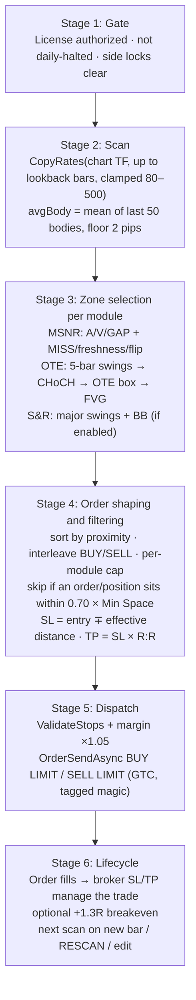

# GOLD SCALPER NINJA — GSN SNR SYSTEM
## Complete Operating Manual & Technical Specification · From First Install to Confident Live Operation

*Platform: MetaTrader 5 · Instrument: XAUUSD / GOLD · Chart timeframe: any (H1 / M30 / M15 / M5 runtime presets) · Edition: SNR System (source v2.00)*

> *"The entry is not a guess about the next candle. It is a resting order at a level that has already proven itself — and it carries its own stop."*

> **Documentation note.** This specification is derived directly from the `GoldScalperNinja_SNR.mq5` source and its `include/` modules (v2.00). It describes **the source**, not any particular compiled `.ex5` build. If you received a different binary, confirm its build date and behaviour before relying on these numbers.

---

## Welcome — Read This Page Before Anything Else

Thank you for running **Gold Scalper Ninja — GSN SNR System**. This document is an operating manual and a technical specification at the same time: every mechanism is explained by **why it exists** before we talk about **what value to use**. Every setting is named exactly as it appears in the EA's inputs window (press `F7` on the chart) or on the on-chart **SNR Command Deck**.

The SNR System is deliberately **not** a grid or martingale EA. It never chases price, never averages a losing position, and never opens a second order to rescue the first. It rests limit orders at structural levels and lets each order die on its own stop loss. Read **Part I** and **Part II** before attaching the EA to a live account.

### How to Read the Callout Boxes in This Manual

- **✓ Recommended** — The setting or workflow we suggest for most accounts. Start here; only deviate once you have seen live behavior on demo.
- **i Explanation** — Plain-English explanation of a trading concept or an internal MQL5 rule, with a concrete number on XAUUSD.
- **★ Pro Tip** — A subtle behavior of the EA that experienced operators use for extra safety or extra selectivity.
- **! Warning** — Settings or habits that can create real losses if misunderstood. Read every warning twice.

### A Quick Word About "Points" and "Dollars" on Gold (XAUUSD)

Distances in this manual are expressed in **price units on the quote**, which is what the EA's inputs use:

- On a **2-decimal** broker (price `2650.25`), `$1.00` of price distance is `100` raw points.
- On a **3-decimal** broker (price `2650.250`), `$1.00` of price distance is `1,000` raw points.

> **i Automatic digit normalization**
> `CCoreEngine` derives points-per-pip from the symbol (Gold with 3 digits is treated as 100 points per pip), so every internal conversion between pips and price is broker-digit safe. Your inputs remain in **price distance** (`SL Dist = 5.00` means `$5.00` of gold movement), never in broker points.

> **! A $5 stop is not a $5 loss**
> `SL Dist ($) = 5.00` is a **quote-price distance**, not an account risk. Account risk also depends on lot size, contract size, account currency, spread and slippage. `0.02` lot on XAUUSD with a `$5.00` stop is roughly `$10` before costs on a standard 100 oz contract — always compute it for your broker and deposit.

---

## Table of Contents

- **Part I — How the SNR System Trades**
  - In One Sentence & The Five Core Mechanisms
  - Lesson 1 · The Life of One Scan-and-Deploy Cycle
  - Lesson 2 · The Three Engines in Detail (MSNR · ICT CHoCH/OTE · Dynamic S&R)
  - Lesson 3 · Two Numbers That Decide What Actually Reaches the Market (Cap & Spacing)
- **Part II — The On-Chart SNR Command Deck**
  - Layout, Live Telemetry & The Four Action Buttons
  - Zero-Click Config Strip (Auto-Applied Edits)
- **Part III — Input Settings (`F7`) — Every Setting, in Plain Words**
  - Runtime preset table (what your untouched defaults really become)
  - Input reference with defaults and effective behaviour
- **Part IV — License, Telemetry, Installation & Risk**
  - License gate and what happens when it locks
  - Telemetry and trade sync
  - Installation in ten minutes
  - Risk controls, troubleshooting and source map

---

# PART I · HOW THE SNR SYSTEM TRADES

*Before you touch a single parameter, understand the personality of the machine you are putting in charge of your money.*

## In One Sentence

**GSN SNR System** is a **limit-order execution EA** for **XAUUSD** that scans three independent zone engines — **MSNR candle-body support/resistance (A / V / GAP, RBS / SBR flips)**, **ICT CHoCH/BOS structure with Fibonacci OTE (0.618–0.786) and fair-value-gap confluence**, and an optional **Dynamic S&R / major-swing / Bollinger** engine — and rests **BUY LIMIT and SELL LIMIT** orders at those levels, each with its **own broker-side stop loss and take profit**, a **fixed base lot**, a minimum price spacing, and a per-module pending cap.

There is no averaging, no multiplication of lots, no basket recovery, and no market entry.

---

## The Five Core Mechanisms

### Mechanism 1 · MSNR body levels with a MISS-freshness lifecycle

The MSNR engine reads **candle bodies, not wicks**. It looks for three structures formed by two consecutive closed candles:

- **A-peak (resistance)**: previous candle bullish, current candle bearish. The level is `max(previous close, current open)`. The level must also be a peak on a **line chart** — it must not be lower than any of the two open/close values on each side.
- **V-valley (support)**: previous candle bearish, current candle bullish, mirrored rule.
- **GAP junction (hidden/decision level)**: two same-direction candles with an engulfing displacement body, at the origin of an impulse — not every bar of a runaway trend. The level is the current candle's open, with a small body-scaled band around the overlap.

A level only becomes a tradeable zone if it passes the **lifecycle rules**:

| Rule | What it demands |
| :--- | :--- |
| **MISS** | The third candle must move away and its wick must **fail to touch** the level (within `0.0375 × avgBody` tolerance). |
| **Freshness** | **Zero wick touches** after formation. The one exception (the source's "rare case") allows a single touch only when the third candle is a strong **confirmation candle** in the trade direction **and** the pair was an engulfing. |
| **Not broken** | Any later body close decisively beyond the zone invalidates the level. |
| **Flip (RBS / SBR)** | A *support* broken by a **clean bearish body** (≥ `0.65 × avgBody`) at least `0.15 × avgBody` below the zone becomes a fresh **SBR resistance** — but only if the breakout *missed* (moved away) and was **never touched or reclaimed** afterwards. The mirror produces **RBS support**. |

Zones are labelled on the chart as `MSNR A-RES`, `MSNR V-SUP`, `MSNR GAP-R`, `MSNR GAP-S`, `MSNR SBR` or `MSNR RBS`, with `[EG]` appended when the formation was an engulfing.

> **i Why this matters**
> A 20-bar-old "resistance" that price has already poked three times is not a resistance any more — it is a resting liquidity pocket. The MISS + freshness filter is the difference between a level market makers defend and a line drawn from hindsight.

### Mechanism 2 · ICT structure: CHoCH impulse + OTE golden pocket + FVG confluence

1. The engine finds **5-bar fractal swing highs and lows** (strictly higher/lower than five neighbours on each side).
2. It pairs a swing low with the highest swing high that preceded it (within a 45-bar window) and requires an impulse leg of at least `2.5 × avgBody`.
3. A **CHoCH/BOS** is confirmed when a later candle **closes** beyond the broken swing level.
4. The **OTE box** is drawn from the swing extreme back into the impulse leg at **0.618 / 0.705 / 0.786**.
5. The zone is **invalidated** if price later closes beyond the origin or wicks beyond the 0.786 boundary.
6. A **fair value gap (FVG)** of at least **$0.50** overlapping the OTE band promotes the entry.

Entry selection order for a sell (mirrored for a buy): **FVG point inside the pocket → 0.618 → 0.705 → 0.786**, whichever is far enough from current price. Only **one bearish and one bullish OTE box** are kept per scan; the primary box wins.

> **i Why the deep pocket**
> Retracements that stop at 0.5 are where late breakout buyers sit. 0.618–0.786 is where the impulse left an imbalance and where stop hunts typically exhaust. The EA demands that depth rather than the shallow first pullback.

### Mechanism 3 · Optional Dynamic S&R engine

Disabled by default. When enabled, it scans **major 5-bar swing levels** that are still **fresh** — not closed through beyond `0.20 × avgBody`, not wicked through beyond `0.30 × avgBody` — and awards extra weight when the swing extreme also pierced the **Bollinger Band (20, 2.0)** on the formation bar or the latest closed bar (`[BB]` label).

### Mechanism 4 · Hard SL/TP on every single limit order

Every deployed limit carries:

- **Entry** = the zone price, normalized to the symbol's digits.
- **SL distance** = `max(SL Dist, 1.5 × broker minimum stop distance)` — widened to `zone depth + 10 pips` when the zone is deeper than the configured stop (but never beyond `1.5 ×` the configured stop).
- **TP distance** = `effective SL × R:R` (never below `1.5 ×` the broker minimum).
- **Order type** = `BUY LIMIT` / `SELL LIMIT`, `GTC`, with a module tag comment (`GSN_MSNR`, `GSN_OTE`, `GSN_SNR`).

Orders are placed through an internal executor that uses **`OrderSendAsync`** first and falls back to a synchronous send, so a burst of limits does not block the terminal.

> **★ Pro Tip**
> Because the stop is attached at placement, a filled order is protected even if you close the terminal, the VPS drops, or the license later locks. There is nothing to "manage" while you are away — that is the design intent.

### Mechanism 5 · Optional protections and readable context

- **Daily drawdown gate** (`Max Daily Loss %`, OFF at `0.0`): once equity falls by the configured percentage from **day-start equity**, the EA stops **new deployment** for the rest of the day. It does not close positions and does not cancel their stops.
- **Breakeven** (`Auto Breakeven`, OFF): after `+1.3 × SL Dist` of open profit, attempts to move the stop to entry ± 5 points, subject to broker stop levels.
- **H1 Storyline**: a pure price-action read of the most recent H1 A-peak / V-valley and breakout, shown in the panel as `BULLISH (BUY)`, `BEARISH (SELL)` or `RANGING`. It is **context and telemetry only** in this build — it never vetoes a limit order.
- **Spread and session checks** exist in the code but currently **return true**; there is no spread, news or session block.

> **! Warning**
> Do not read the H1 Trend line, the session label or the rosette of green UI elements as protection. In v2.00 the only active entry gates are: license state, daily drawdown gate, side lock, spacing/cap, and broker validation. Everything else is information.

---

## Lesson 1 · The Life of One Scan-and-Deploy Cycle

Every cycle is the same five steps. Understanding them is 80% of operating the EA:



| Stage | What Happens on the Chart | Governing Functions & Settings |
| :--- | :--- | :--- |
| **1. Gate** | License must be authorized, the daily gate must not be tripped, and the side must not be locked by `DELETE BUY` / `DELETE SELL`. | `UpdateLicenseGate()`, `CRiskManager::IsDailyHalted()`, `cfg.buyLocked/sellLocked` |
| **2. Scan** | Reads chart-timeframe candles on the **current symbol and period** (the EA does not open other timeframes for signals; the H1 read is context only). | `CSignalEngine::ScanAllModules()`, `InpLookbackBars` (80–500), `CalculateAverageBody(50)` |
| **3. Zone selection** | Draws rays / boxes on the chart for every accepted zone; de-overlaps labels so levels stay readable. | `ScanMsnrModule()`, `ScanChochOteModule()`, `ScanDynamicSnrModule()` |
| **4. Order shaping** | Sorts candidates by distance to the market, then **interleaves sell/buy** so neither side starves, up to the per-module cap (MSNR additionally caps each side at `ceil(cap / 2)`). | `SortZonesByProximity()`, `maxPerSide = ceil(cap / 2)` |
| **5. Dispatch** | Deploys limits with individual stops and targets; counts in-flight dispatches so an async burst never double-places. | `CTradeManager::DeployModuleLimits()`, `CSnrTrade` |
| **6. Lifecycle** | Filled orders are purely broker-managed; the EA optionally moves the stop to breakeven at +1.3R. | `ManageActivePositions()` → `ManageSingleModeModule()` |

> **i Scans are event-driven, not continuous**
> A new limit is only created by: EA start, a new chart candle (`Auto Rescan New Bar`), `RESCAN CHART`, a module toggle, or a change in the config strip. Between those events the pending set is static. This is intentional — re-pricing limits on every tick is how EAs "chase" the market.

---

## Lesson 2 · The Three Engines in Detail

### Engine 1 · MSNR (module 1, ON by default)

| Parameter of the rule | Value in the source |
| :--- | :--- |
| Bars scanned | from bar `3` back to `lookback − 4` (the newest candles are excluded until they are closed and settled) |
| Average body | mean `abs(close − open)` of the last **50** bars, floored at **2 pips** |
| Doji filter | skip when **both** candle bodies < `0.25 × avgBody` |
| Engulfing (EG) | `bodyCurr ≥ 1.05 × bodyPrev` **and** `bodyCurr ≥ 0.85 × avgBody` |
| GAP displacement | previous or current body ≥ `1.15 ×` / `1.25 × avgBody`, plus a quiet opposite (`prev2` opposite colour or `prev2 body < 0.75 × avgBody`) |
| Zone spacing | `max(Min Space, max(1.15 × avgBody, 0.85 × SL Dist))` |
| Per-side cap | `ceil(effective cap / 2)` |
| Internal score | `(touches == 0 ? 100 : 75) + (EG ? 25 : 0) − barIndex × 0.1` — recorded on the zone; in v2.00 selection is by **proximity**, not score |

### Engine 2 · ICT CHoCH/BOS + OTE (module 2, ON by default)

| Parameter of the rule | Value in the source |
| :--- | :--- |
| Swings | 5-bar fractals, strict on both sides, up to 60 highs + 60 lows per scan |
| Origin pairing | swing high within `(low_bar − 5 … low_bar + 45]`, highest wins |
| Minimum leg | `≥ 2.5 × avgBody` |
| Break confirmation | body **close** beyond the swing level (`InpBreakSrc = 0`) |
| OTE band | `0.618 / 0.705 / 0.786` of the impulse leg |
| FVG minimum | **`$0.50`** (hard-coded `fvgMinPrice`; the code comment calls it "5.0 pips / InpFvgMinPip") |
| FVG pick | first qualifying gap scanned from the origin toward the extreme |
| Invalidation | any close beyond the origin, or any wick beyond 0.786, after the impulse extreme |
| Boxes per scan | at most one bearish + one bullish primary box |
| Score | `135` with FVG, `120` without, minus `5 × swing index` (recorded, not used for priority in v2.00) |

### Engine 3 · Dynamic S&R (module 3, **OFF** by default)

| Parameter of the rule | Value in the source |
| :--- | :--- |
| Swings | major 5-bar fractals, strict on both sides |
| Direction gate | level ≥ `ask + Min Space` for sells; ≤ `bid − Min Space` for buys |
| Freshness | not broken by a close beyond `level ± 0.20 × avgBody`, nor a wick beyond `± 0.30 × avgBody` |
| Bollinger confluence | BB(20, 2.0) on the chart timeframe; swing extreme at/through the band on the formation bar or last closed bar |
| Score | `95` with BB, `85` without (`[BB]` label) |
| Spacing | `max(Min Space, max(1.15 × avgBody, 0.85 × SL Dist))` |

---

## Lesson 3 · Two Numbers That Decide What Actually Reaches the Market

Scanning produces *candidates*. Deployment is a separate, strict filter, and two numbers dominate it:

1. **`Max Pending` (per module).** The cap counts **BUY + SELL pending orders of that module**, not per side and not across the EA. With MSNR and OTE enabled at `6`, the ceiling is `12` live pending orders; enabling Dynamic S&R as well raises it to `18`. Filled positions are **not** counted — they free capacity for the next scan.
2. **`Min Space ($)`.** Also used as the duplicate guard at `0.70 ×` the value. If an order or a position already sits within `0.70 × Min Space` of a candidate, the candidate is skipped — this is what prevents a cluster of three limits around the same level.

> **Worked example (H1 defaults)**
> Chart H1, untouched inputs. Runtime preset: lot `0.02`, SL `$10.00`, spacing `$10.00`, R:R `2.00`, so TP is `$20.00`. Suppose price is `2650.00` and MSNR finds an A-peak at `2662.00` and a V-valley at `2638.00`. Both pass spacing. The EA deploys `SELL LIMIT 0.02 @ 2662.00, SL 2672.00, TP 2642.00` and `BUY LIMIT 0.02 @ 2638.00, SL 2628.00, TP 2658.00`. On a later rescan, an A-peak at `2662.50` is rejected at deployment because an EA order already rests within `0.70 × $10.00 = $7.00` of it — and the scan itself would already have dropped any same-scan level closer than `$10.00` to another zone.

> **! Warning — additive exposure**
> Each pending is an independent order with its own stop. In a fast trending day, *all* the resting limits on one side can fill and all their stops can be hit. The per-order risk is bounded; the portfolio risk is not. Size the base lot for the worst realistic case (cap × lot × SL distance), not for one order.

---

# PART II · THE ON-CHART SNR COMMAND DECK

The deck is a `600 × 404 px` panel (collapsible to `54 px`), drawn with chart objects in the GoldScalperNinja visual language. Drag it by the header to reposition it; the panel is clamped inside the chart window.

| Row | Content | Notes |
| :--- | :--- | :--- |
| **Header** | `GOLD SCALPER NINJA - SNR SYSTEM` + `[ HIDE ]` / `[ SHOW ]` | Minimizing collapses the panel and stops UI updates, not trading |
| **Capital** | `BALANCE` with `( ±$X Today )` · `EQUITY` with `Max DD : x.xx%` | Today's figure is **realized** P&L from this EA's closed deals today; Max DD is since attach |
| **Trade metrics** | `PnL Today` · `FLOATING P/L` · `LOTS TOTAL` | Floating P&L covers only this EA's positions (profit + swap) |
| **Chart information review** | `EA ACTIVE : ON / LIC LOCKED / DD HALT` · Broker · Spread · Account (`LIVE`/`DEMO` + leverage) · H1 Trend · Positions `BUY n (lots) \| SELL n (lots)` · Pendings `BUY n [LOCK] \| SELL n [LOCK]` | This is the fastest place to diagnose "why is nothing being placed" |
| **Module cards** | `MSNR ENGINE` · `CHOCH OTE` · `DYNAMIC S&R` toggles, each with `P:buy/sell \| O:open \| floating` | Toggling a module **off** immediately deletes its pending orders |
| **Config strip** | `Base Lot` · `SL Dist ($)` · `R:R Ratio` · `Min Space ($)` · `Max Pending` + `TP Target` preview | Edits apply automatically (see below) |
| **Action dock** | `DELETE BUY` · `DELETE SELL` · `CLOSE ALL` · `RESCAN CHART` | Buttons are debounced; heavy actions use a 1-second cooldown |

### The four action buttons — exact behaviour

| Button | What it does | What it does **not** do |
| :--- | :--- | :--- |
| `DELETE BUY` | Deletes every **buy-side pending** of this EA on this symbol, then sets `buyLocked = true` | Does not close open BUY positions |
| `DELETE SELL` | Mirror of the above for sell-side pendings | Does not close open SELL positions |
| `CLOSE ALL` | Closes every **open position** belonging to this EA's three magic numbers on this symbol | **Does not delete pending orders** — use the two DELETE buttons |
| `RESCAN CHART` | Applies pending field edits, clears **both** side locks, deletes **all** pending orders, rescans, redeploys | Does not close positions |

> **★ Pro Tip — the side lock is your manual veto**
> `DELETE BUY` is not just a cleanup. It locks the buy side until the next `RESCAN CHART` or EA restart, so a single click removes your long bias for the session without disabling the EA. The panel shows `[LOCK]` next to that side so you cannot forget.

> **! Warning — CLOSE ALL is not "flatten everything"**
> Your pending orders survive `CLOSE ALL` and can fill later. To be truly flat: `CLOSE ALL`, then `DELETE BUY`, then `DELETE SELL`.

### What the chart drawings mean

| Drawing | Appearance | Meaning |
| :--- | :--- | :--- |
| MSNR level ray | dashed, orange-red for sell / gold for buy | A body-based A / V / GAP level or RBS / SBR flip that passed the MISS and freshness rules |
| Dynamic S&R ray | dotted, deep pink for sell / aqua for buy | A fresh major 5-bar swing level (optionally with `[BB]` Bollinger confluence) |
| OTE box | filled rectangle (dark red sell / dark green buy) | The `0.618 – 0.786` golden pocket of the active impulse |
| CHoCH line | dotted horizontal line | The swing level whose body close confirmed the structure break |
| Swing arrows | down arrow at highs, up arrow at lows | The 5-bar fractals used by the OTE engine |
| Price tags | small text at the right edge | Level label + entry price; labels auto-re-align so they never overlap |

All objects are prefixed with the EA's chart namespace and are deleted when the EA reinitialises or is removed.

### Zero-click config strip (auto-applied edits)

Change any of the five fields and the change is picked up on the next tick / timer tick — no Apply button:

| Field | Accepted range | Side effect |
| :--- | :--- | :--- |
| `Base Lot` | > 0, normalized to broker min/step/max | Deletes **all** pendings, redeploys with the new lot |
| `SL Dist ($)` | > 0 | Deletes all pendings, redeploys with the new stop (and therefore new TP) |
| `R:R Ratio` | ≥ 0.2 | Deletes all pendings, redeploys with the new target |
| `Min Space ($)` | ≥ 0 | Triggers a **full rescan** first, then redeploys |
| `Max Pending` | 1 … 30 (source ceiling) | Deletes all pendings, redeploys up to the new cap |

Redeployment is skipped when there are no zones, when the license is locked, or when the daily gate is halted. Every applied change is written to the Experts log:

```
[GSN-SNR] Auto-Applied Input: Lot=0.02 SL=$10.00 TP=$20.00 (RR=1:2.00) MinSpace=$10.00 MaxPend=6
```

---

# PART III · INPUT SETTINGS (`F7`) — EVERY SETTING, IN PLAIN WORDS

## First: your defaults are not the runtime values

`InitRuntimeConfig()` runs **before** the engines start and rewrites lot / stop / spacing when an input still holds its declared default. This is the single most misunderstood part of the EA.

| Chart timeframe | Base lot | SL distance | Min spacing | R:R | Resulting TP distance |
| :--- | :--- | :--- | :--- | :--- | :--- |
| **H1 or slower** (H1, H2, H4, D1…) | `0.02` | `$10.00` | `$10.00` | `2.00` | `$20.00` |
| **M30** | `0.04` | `$7.50` | `$6.00` | `2.00` | `$15.00` |
| **M15** | `0.02` | `$5.00` | `$3.50` | `2.00` | `$10.00` |
| **M5** | `0.01` | `$4.00` | `$1.50` | `2.00` | `$8.00` |
| **Any other timeframe** (e.g. M1) | `0.02` | `$5.00` | `$1.50` | `2.00` | `$10.00` |

The preset only applies while the corresponding input still equals the declared default (`InpBaseLot == 0.02`, `InpSlPriceDist == 5.00`, `InpMinPriceDist == 1.50`). Type **any other value** and that value is used on every timeframe unchanged (subject to broker minimums).

> **i Read this twice**
> The stop distances in the table are **quote-price** distances, and the TP is `SL × R:R`. There is no dollar-risk percentage anywhere in this EA. If you want a consistent dollar risk across timeframes, either switch timeframe deliberately or set the inputs explicitly.

## Input reference

### License & telemetry

| Input | Default | Behaviour |
| :--- | :--- | :--- |
| `InpSyncApiKey` | *(empty)* | Personal `TNT-XXXX-XXXX-XXXX` key. If empty, the EA tries the telemetry-cached key, then the per-account cached key, then the license cache. With checks enabled, an unverified key **blocks new deployment** and deletes pendings; open positions remain managed. |
| `InpSyncApiUrl` | `https://thenexttrade.app` | Primary license/telemetry server. Failover tiers use `https://raw.githubusercontent.com` (and `https://api.github.com` for the repo lookup). Allow all three in MT5 → Tools → Options → Expert Advisors → WebRequest. |

### Strategy modules

| Input | Default | Behaviour |
| :--- | :--- | :--- |
| `InpEnableMsnr` | `true` | Module 1 — A/V/GAP, MISS freshness, RBS/SBR flips. |
| `InpEnableOte` | `true` | Module 2 — 5-bar swings, CHoCH/BOS, OTE 0.618–0.786, FVG confluence. |
| `InpEnableSnr` | `false` | Module 3 — major swing S&R with Bollinger context. |
| `InpLookbackBars` | `240` | Bars copied for the scan; clamped to **80–500**. Fewer bars = fewer historical levels; more bars = older, likely-swept levels. |

### Entry & SL/TP

| Input | Default | Behaviour |
| :--- | :--- | :--- |
| `InpBaseLot` | `0.02` | Fixed lot for every limit, normalized to the broker's min/step/max. **Never multiplied.** Unchanged default activates the runtime table above. |
| `InpSlPriceDist` | `5.00` | Configured stop distance in price. Effective per order = `max(this, 1.5 × broker min stop)`, optionally widened to `zone depth + 10 pips` (capped at `1.5 ×`). Unchanged default activates the runtime table. |
| `InpRrRatio` | `2.00` | `TP distance = effective SL × R:R`. Minimum accepted `0.2`. In v2.00 an untouched `2.00` **stays `2.00`**. |
| `InpMinPriceDist` | `1.50` | Minimum distance from current market and between levels; also the `0.70 ×` duplicate guard. Unchanged default activates the runtime table. |
| `InpMaxPending` | `6` | Combined BUY+SELL pending cap **per module**, clamped to `1–30`. MSNR caps each side at `ceil(cap / 2)`; OTE keeps at most one box per side; Dynamic S&R interleaves nearest sell/buy up to the cap. |
| `InpAutoBreakeven` | `false` | When on: at `+1.3 × InpSlPriceDist` of open profit, move SL to entry ± 5 points, if that improves the current stop and respects broker stop levels. Uses the **configured** SL distance, not the structural widening. |
| `InpAutoRescanNewBar` | `true` | New closed chart candle → rescan + deploy (respecting locks, cap, license and daily gate). |
| `InpEnforceTrend` | `true` | Tracks the H1 Storyline for the panel label. In this source it does **not** veto counter-storyline orders. |

### Protection, magic & dashboard

| Input | Default | Behaviour |
| :--- | :--- | :--- |
| `InpMaxDailyLossPct` | `0.0` (OFF) | Daily circuit breaker measured from **day-start equity**. When tripped, new deployment stops for the rest of the day; positions and their stops are untouched. Resets on the next server day. |
| `InpMagicBase` | `20260900` | Module magics are `Base`, `Base+1`, `Base+2`. All management (delete, close, stats) is restricted to this range and this symbol. |
| `InpSlippagePoints` | `20` | Requested deviation. The executor raises it to at least `max(100, 3 × current spread)` internally. |
| `InpEnableDashboard` | `true` | Shows the command deck and chart drawings. Turning it off does not change trading. |

---

# PART IV · LICENSE, TELEMETRY, INSTALLATION & RISK

## License gate

The EA resolves its key in four steps — input, telemetry cache, per-account cache, license cache — then validates every `1800` seconds (30 minutes) plus an account-switch check on a 1-second timer.

- **Authorized**: scanning and deployment proceed; on a transition from locked → unlocked the EA rescans and redeploys immediately.
- **Locked** (invalid key, account mismatch, not IB-verified, revoked, or cache older than 72 hours with no reachable server): `g_trade.DeleteAllPendings()` runs and the panel shows `EA ACTIVE : LIC LOCKED`.
- **Open positions remain managed** after a lock — their broker-side SL/TP are untouched, and optional breakeven continues.

Validation tiers: web API → GitHub `accounts.csv` backup → signed 72-hour local cache (FNV-1a signature bound to account, expiry, key and salt). A definitive rejection from the web server **does not** fall through to GitHub.

> **i Testers and demos**
> In the Strategy Tester, license checks are bypassed. On a live account, the gate is active unless the shared telemetry include is compiled with checks disabled.

## Telemetry and trade sync

- Initialized as `productSlug = gsn-snr-system`, name `GoldScalperNinja - SNR`, version `2.00`, with a **600-second** heartbeat and sync interval in this build.
- Every trade transaction is forwarded to the sync engine, which uploads this EA's closed deals (`DEAL_ENTRY_OUT` / `INOUT` / `OUT_BY`) to the web journal. The panel's `PnL Today` is computed locally from today's closed history of this EA, not from the sync counters.
- The server records account type (`REAL` / `DEMO`) so demo balances never inflate farm capital.
- On deinit, the EA prints a session summary:
  `[GSN-SNR SUMMARY] Closed Deals=… (W:… / L:…) | WR=…% | PF=… | Net=$… | MaxDD=…%`

## Installation in ten minutes

1. **Allow WebRequest** for `https://thenexttrade.app`, `https://raw.githubusercontent.com` and `https://api.github.com` (MT5 → Tools → Options → Expert Advisors).
2. Copy the compiled `.ex5` to `MQL5/Experts` (or compile the source with its `include/` folder and the shared `GSN_EA_Telemetry.mqh` / `GSN_EA_License.mqh` available to MetaEditor) and refresh the Navigator.
3. Open an **XAUUSD** chart on the timeframe you intend to trade. The timeframe *is* the strategy timeframe — all scans read the current chart period.
4. Attach the EA, enter your license key, and enable **Algo Trading**.
5. Confirm the panel shows `EA ACTIVE : ON`, then run `RESCAN CHART` once and verify the drawn rays/boxes and the pending orders in the Terminal tab.
6. Keep the terminal (or VPS) connected — the EA must be running to scan, deploy and report telemetry.

> **★ Pro Tip — verify on demo with real spreads**
> Run at least two weeks on a demo account **with the same broker server** you will trade live. Check the Experts log after each new bar: zones detected, orders skipped (spacing/cap/margin) and any `ValidateStops` rejection tell you exactly which filter is binding.

## Risk controls and honest limitations

| Topic | Reality in v2.00 |
| :--- | :--- |
| **Fixed lot** | There is no risk-percentage sizing, no martingale and no recovery ladder. Risk scales only with how many limits fill. |
| **Stop is a price distance** | Account risk = lot × contract × price distance × currency conversion + spread/swap. Compute it yourself. |
| **Correlated fills** | All limits rest simultaneously; a one-way day can fill every one on the losing side. Cap `InpMaxPending` and base lot accordingly. |
| **No news / session / spread filter** | The hooks exist but are permissive. If you need them, they must be added — do not assume protection. |
| **H1 storyline** | Informational only. It is not a trend gate in this build. |
| **Breakeven** | Optional and based on the configured SL, not the structural stop; it can still be skipped by broker stop-distance rules. |
| **Gaps and slippage** | Stops are broker-side, but weekend gaps and fast markets can fill beyond the stop price. |
| **Backtests** | The custom `OnTester` score is `PF×20 + Sharpe×10 + Recovery×10 − MaxDD%×1.5`, zero below 10 trades or zero net profit. It ranks parameter sets; it does not predict live results. |

## Troubleshooting

| Symptom | Likely cause | Check |
| :--- | :--- | :--- |
| No pending orders at all | License locked, daily gate tripped, both sides locked, or no zone passed filters | Panel header state, `[LOCK]` flags, Experts log |
| Orders appeared then vanished | Module toggled off, `RESCAN`, edit applied, or license locked mid-session | Experts log lines from `DeleteAllPendings` callers |
| Only one side has orders | Opposite side locked, spacing guard around an existing order, or `maxPerSide` reached | `Pendings BUY/SELL` line, chart rays |
| Lot/stop differ from F7 | Runtime preset table applied (inputs left at defaults) | Config strip + Experts log at init |
| TP looks like `SL × 2` but you expected more | `InpRrRatio` is `2.00` in this source; it is not rewritten to `4.00` | Config strip `R:R Ratio` and `TP Target` |
| `CLOSE ALL` left orders on the chart | By design — pendings are separate | Press `DELETE BUY` and `DELETE SELL` |
| Breakeven did not move the stop | Profit below `+1.3 × SL Dist`, or the target stop is inside the broker's stop level / worse than the current stop | Position tab, symbol stops level |

## Source map (what implements what)

| File | Layer | Responsibility |
| :--- | :--- | :--- |
| `GoldScalperNinja_SNR.mq5` | entry | Inputs, runtime presets, license gate, tick/timer/event wiring, `OnTester` score |
| `include/Defines.mqh` | model | Version, magic offsets, enums, zone/box/config/stat structs |
| `include/CoreEngine.mqh` | layer 0 | Symbol constraints, pip↔point scale, stop validation, filling mode, new-bar timer |
| `include/RiskManager.mqh` | layer 1 | Lot normalization, margin check (`×1.05`), daily equity-drawdown gate, daily realized P&L |
| `include/RegimeFilter.mqh` | layer 2 | H1 storyline regime + session label (context only) |
| `include/SignalEngine.mqh` | layer 3 | MSNR, ICT CHoCH/OTE, Dynamic S&R, chart drawing and label de-overlap |
| `include/TradeManager.mqh` | layer 4 | Async order executor, deployment, caps, spacing, side locks, optional breakeven, module stats |
| `include/Analytics.mqh` | layer 5 | Command deck, live telemetry, auto-applied edits, deal counters, session summary |
| `Include/GSN_EA_Telemetry.mqh` | shared | License validation tiers, heartbeat, trade sync, GitHub failover |

---

*End of specification — GSN SNR System, source v2.00. Derived from the supplied EA source; review the effective configuration on the command deck before enabling live execution.*
